# gopf 架构详解

> 这是一份写给"网络零基础、Zig 零基础、C 零基础"读者的架构文档。
>
> 你会先用类比建立直觉，再看到这份代码里每一处关键设计对应的真实代码。
> 读完之后，你应该能回答三个问题：一条连接在 gopf 里走了哪些路？为什么这样设计？
> 如果要改一个功能，应该动哪个文件？

| 项目 | 内容 |
| --- | --- |
| 文档对象 | `codex/` 目录里的 gopf 实现 |
| 语言与版本 | Zig 0.17.1（`zig version` 输出） |
| 目标平台 | Linux、macOS（代码里对其它平台直接编译报错） |
| 第三方依赖 | 无。只链接系统 libc，其余全部来自 Zig 标准库和系统调用 |
| 源码规模 | 7 个 Zig 文件，1440 行；`build.zig` 另算 |
| 文档基线 | 2026-11-21。文中 `文件:行号` 对应这份代码 |
| 验证情况 | macOS ARM64 + Zig 0.17.1 下，`zig build test` 8/8 通过，ReleaseFast 构建通过。回环运行验证覆盖 HTTP 转发、状态输出、重载成功与失败、旧连接沿用原后端和退出。`x86_64-linux.3.10-musl` 的 ReleaseFast 交叉编译通过 |

---

## 0. 阅读指南

### 0.1 按目标选阅读路线

这份文档很长，因为"零基础"意味着要同时补网络、Zig、C 三门课。你不必按顺序读完。

| 你的目标 | 建议顺序 | 大约需要 |
| --- | --- | --- |
| 只想把它跑起来 | 0 → 8.1 → 8.7 | 20 分钟 |
| 想知道它整体怎么工作 | 0 → 1 → 4 → 6 → 5.6 | 1 小时 |
| 想真正读懂代码 | 0 → 1 → 2 → 3 → 4 → 5 → 6 | 半天到两天 |
| 想改它、扩展它 | 上面全部，再加 7、9 | 两天以上 |

第 2 章讲网络，第 3 章讲 Zig 和 C。如果你已经会这些，直接跳过，但从第 4 章开始会遇到 `epoll`、`kqueue`、`fd`、`errno` 这些词，卡住时回来查对应小节即可。

### 0.2 本文的约定

- `src/worker.zig:287` 表示文件 `src/worker.zig` 的第 287 行。行号基于写作时的代码；代码改动后行号会漂移，按函数名或符号名搜索更可靠。
- "内核"指操作系统负责管理硬件和进程的核心部分。程序通过系统调用请求内核建立连接和收发数据。
- "fd"是 file descriptor（文件描述符）的缩写，第 2.3 节会解释。
- 代码块里的 `// ←` 是本文加的讲解注释，原代码里没有。
- 命令示例以 macOS ARM64 + Zig 0.17.1 为基线。平台差异见对应章节，复测范围见上表。

### 0.3 关于 Zig 版本的提醒

Zig 还没有发布 1.0，标准库 API 在版本之间会变。这份代码使用了 0.17.1 中的接口，例如 `pub fn main(init: std.process.Init)`、`std.Io`、`std.Io.Mutex`、`std.Io.Dir`。你在网上看到的旧教程（0.11、0.12、0.13）很多写法在这里编译不过。

本文以 0.17.1 为准。换版本时可用 `zig version` 确认本机版本，再查该版本的发布说明和标准库。

---

## 1. 这个程序是什么

### 1.1 一句话版本

gopf 是一个 **TCP 四层负载均衡器**，也叫端口转发器。它在一个 `IP:端口` 上接受 TCP 连接，按权重随机挑一个后端，把连接接到后端，然后在两个方向搬运字节。

"四层"是网络分层里的说法：它按 TCP 连接选后端，透明转发应用层字节。它不知道 HTTP 请求行、Header、Body 是什么，眼里只有字节流。所以它也能转发 MySQL、Redis、WebSocket，以及任何跑在 TCP 上的协议。

### 1.2 它解决什么问题

假设你有三个后端服务，分别监听 `127.0.0.1:9001`、`9002`、`9003`，你想让外部只看到一个入口 `12481`，并且把新建 TCP 连接大致按 1:2:1 分过去。这个比例是大量连接的期望值。一个 HTTP 长连接上的多条请求都去同一个后端。

客户端只需连接统一入口，gopf 根据配置选后端。后端看到的是 gopf 发起的一条普通 TCP 连接。流量分配由 gopf 负责，客户端和后端都可以沿用现有协议。

### 1.3 三个角色和一份配置

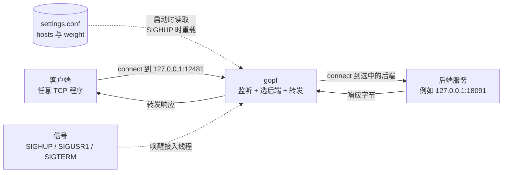

| 角色 | 在代码里的位置 | 说明 |
| --- | --- | --- |
| 客户端 | 不在这份代码里 | 发起连接、读写数据。可能是 curl、浏览器、另一个服务 |
| gopf 接入线程 | `src/main.zig:115` 的 `Acceptor` | 主线程。accept 新连接、选后端、把连接分给 worker、处理信号 |
| gopf worker | `src/worker.zig:54` 的 `Worker` | 每个 worker 一个线程，用 epoll/kqueue 管一批连接，负责真正的双向转发 |
| 后端 | 不在这份代码里 | 接受 gopf 的拨号，返回响应 |
| 配置 | `settings.conf`，由 `src/config.zig` 解析 | JSON：`{"hosts":[{"addr":"host:port","weight":100}]}` |

### 1.4 一条连接的完整旅程

下面从客户端建立连接开始，追踪到两边关闭为止。

1. 客户端向 `127.0.0.1:12481` 发起 TCP 连接。内核完成三次握手，把这条连接放进监听 socket 的 accept 队列（第 2.4 节）。
2. 接入线程阻塞在 `poll` 上，监听 fd 变可读后醒来，调用 `accept` 拿到一个新的客户端 fd（`src/main.zig:155`）。
3. 接入线程用 `Config.choose` 按权重随机选一个 host，取它的第一个已解析地址作为拨号目标，复制其余地址作为备用列表（fallback）（`src/main.zig:167`）。
4. 接入线程按轮转顺序挑一个 worker，把"客户端 fd + 目标地址 + fallback"打包成 `Job` 放进 worker 的队列（`src/main.zig:173`、`src/worker.zig:116`）。队列从空变非空时，往 wake pipe 写一个字节，唤醒 worker 线程。
5. worker 线程醒来，取出 Job，分配一个连接 id，调用非阻塞 `connect` 拨号（`src/worker.zig:188`、`src/worker.zig:211`）。
6. 如果拨号尚未完成，worker 先向 epoll/kqueue 登记后端 fd 的可写兴趣。等到事件后读取 `SO_ERROR`，失败则尝试备用地址。拨号成功后，worker 释放备用列表，并订阅两端的转发事件（`src/worker.zig:211`、`src/worker.zig:234`、`src/worker.zig:322`）。
7. 客户端发来数据。worker 读到 16 KiB 的共享缓冲区，写到后端。如果后端暂时写不动，剩余字节复制到 `pending`，并 **暂停继续读客户端**（`src/worker.zig:287`）。
8. 后端返回响应，反方向重复第 7 步。
9. 客户端关闭写方向（发 FIN）。worker 读到 0 字节，标记该方向 EOF，对后端调用 `shutdown(SHUT_WR)`，但 **不关闭后端**，因为后端可能还有响应要发（`src/worker.zig:301`）。
10. 两个方向都 EOF 后，worker 关闭两个 fd，移除连接状态，活跃连接计数减一（`src/worker.zig:275`、`src/worker.zig:351`）。

两端连接建立后，即使暂时没有数据，worker 也会保留连接状态并等待事件。第 6.9 节说明了连接、fd 和缓冲区分别占用多少资源。

### 1.5 功能清单

| 功能 | 具体行为 | 代码位置 |
| --- | --- | --- |
| 监听 | `-listen` 指定地址，默认 `:1248`；只接受 TCP | `src/main.zig:74`、`src/sys.zig:84` |
| 后端选择 | 加权随机。总权重为 0 时没有可用后端，关闭客户端连接 | `src/config.zig:71`、`src/main.zig:168` |
| 双向转发 | 两个方向各自独立读写，各自维护积压数据 | `src/worker.zig:287` |
| 半关闭 | 一侧正常 EOF 时只关对端写方向，两侧都正常 EOF 时关闭整条连接 | `src/worker.zig:301`、`src/worker.zig:275` |
| keepalive | 两侧都开 TCP keepalive，空闲 60 秒开始探测，间隔 60 秒 | `src/sys.zig:248` |
| 配置校验 | `addr` 必须符合地址格式，正权重后端须解析出可用地址。`weight` 缺省或为 `null` 时按 0 处理，其他值须为非负整数 | `src/config.zig:42` |
| 热重载 | `SIGHUP` 重新读配置；失败保留旧配置并打日志；已建立连接继续用旧后端 | `src/main.zig:182` |
| 运行状态 | `SIGUSR1` 打印已入队或由 worker 处理的连接数、累计接入数、接入丢弃数和配置摘要 | `src/main.zig:194` |
| 退出 | `SIGTERM`/`SIGINT` 停止接入，主动关闭现有连接及待处理 Job 持有的连接，再等待 worker 退出 | `src/main.zig:135`、`src/main.zig:45`、`src/worker.zig:151` |
| 日志 | accept、拨号失败、重载结果、状态都打到 stderr | 各文件的 `std.debug.print` / `std.log` |
| 容量保护 | 以 16384 为分摊基数，向上取整得到每个 worker 的配额。所有 worker 都拒绝时，接入线程关闭新连接 | `src/main.zig:8`、`src/worker.zig:116` |

### 1.6 设计目标与代价

每个设计都是一次取舍。这张表先说结论，后面的章节解释原因：

| 目标 | 做法 | 代价 |
| --- | --- | --- |
| 每条连接便宜 | 不用"一连接一线程"，改用一个线程管几千连接 | 代码复杂：非阻塞、事件循环、状态机 |
| 内存可预测 | 每个 worker 复用一块 16 KiB 读缓冲；只有写不完时才复制剩余字节 | 每次最多读 16 KiB，每方向最多保留一块待写数据 |
| 多核扩展 | `-workers N` 启动 N 个事件循环线程，连接按轮转分配 | 连接之间不迁移，负载可能不均 |
| 无第三方依赖 | 只用 Zig 标准库和 libc | 没有现成的 HTTP 解析、指标库、TLS |
| 拨号行为简单 | 尝试同一后端的已解析地址 | 地址都失败后关闭客户端连接。何时失败受内核超时影响 |
| 运维友好 | 信号触发重载和状态输出，不需要 HTTP 管理端口 | 无法远程查询状态，只能在终端看 |
| 代码可审计 | 1440 行，无宏、无隐藏控制流 | 功能也少：没有健康检查、访问日志、限流 |

### 1.7 它不是什么

初学者最容易误解的几点，先划清边界：

- **不是 HTTP 反向代理。** 它不解析请求，不改 Header，不做基于路径的路由。成功转发的字节保持内容和顺序。
- **不做健康检查。** 后端挂了，只有被随机选中的那几条连接会失败，gopf 不会把挂掉的后端踢出列表。
- **TLS 透传。** TCP 负载可以是明文，也可以是 TLS 密文。使用 HTTPS 时，TLS 握手和加解密由客户端与后端完成。
- **拨号失败只在选中的后端内尝试其他地址。** 地址都失败后关闭客户端连接。内核的接入队列和 worker 的 Job 队列仍用于等待接入和处理。
- **用户态转发。** 数据先从内核读进 16 KiB 的用户态缓冲，再写回内核。第 7 章对照了 Go 原版在 Linux 上可走的 `splice` 路径。
- **不支持 Windows。** `src/poller.zig:24` 对不认识的平台直接 `@compileError`（第 27 行）。

### 1.8 关键数字

读代码时经常要回头查这些常量。完整表格见附录 B。

| 常量 | 值 | 含义 | 位置 |
| --- | ---: | --- | --- |
| `connection_budget` | 16384 | 连接配额的分摊基数。W 个 worker 各分到 `ceil(16384 / W)`，总配额为 `W × ceil(16384 / W)` | `src/main.zig:8` |
| `accept_batch` | 64 | 一次 poll 醒来最多 accept 多少条 | `src/main.zig:9` |
| `queue_size` | 256 | 每个 worker 的待处理 Job 队列长度 | `src/worker.zig:8` |
| `jobs_per_batch` | 64 | 一次唤醒最多处理多少 Job | `src/worker.zig:9` |
| `chunk_size` | 16 KiB | 每个 worker 复用的读缓冲大小，也是单次读取上限 | `src/worker.zig:10` |
| `buffer_budget_per_slot` | 8 KiB | 每条连接配额折算的积压预算 | `src/worker.zig:11` |
| `max_batch` | 128 | 一次事件等待最多取多少个事件 | `src/poller.zig:18` |
| backlog | 1024 | 传给 `listen` 的排队上限，由内核决定实际队列长度 | `src/sys.zig:89` |
| keepalive | 60 s / 60 s | 空闲多久开始探测 / 探测间隔 | `src/sys.zig:251` |
| 配置大小上限 | 16 MiB | 防止误读巨大文件 | `src/config.zig:17` |

### 1.9 代码规模

```text
src/main.zig          238 行  参数解析、启动、接入循环、信号
src/worker.zig        364 行  每线程事件循环、连接状态机、转发
src/sys.zig           285 行  socket、地址解析、管道与错误映射
src/poller.zig        153 行  epoll / kqueue 的统一封装
src/config.zig        145 行  JSON 解析、校验、加权选择
src/integration.zig   251 行  四个端到端测试及测试夹具
src/tests.zig           4 行  测试入口，把上面的测试模块串起来
```

加在一起 1440 行，但真正的复杂度集中在 `worker.zig` 的 300 多行里。读懂它，这份代码就没有秘密了。

---

## 2. 网络基础：从一个字节怎么走到对面说起

这一章补齐读懂 gopf 所需的网络知识。每一节末尾都会指出对应的代码，你可以边读边打开文件对照。

### 2.1 IP、端口和一条连接

**IP 地址**标识网络地址，**端口**用于把 TCP 流量交给该地址上的监听服务。`127.0.0.1:12481` 的意思是"本机 12481 端口上的程序"。`127.0.0.1` 是回环地址，数据不出网卡，永远回到本机，适合本机测试。

一条 TCP 连接由四个值唯一确定：**源 IP、源端口、目的 IP、目的端口**，合称四元组。所以同一个客户端进程可以同时开几千条连接连同一个服务：每个连接的源端口不同。

- 服务端监听的端口是固定的，比如 gopf 的 12481。
- 客户端连接时，源端口由内核从临时端口范围里挑一个，程序不用管。
- 回环测试里看到的 `127.0.0.1:52341 -> 127.0.0.1:12481` 就是一条连接。

监听 `0.0.0.0:12481` 表示"本机所有 IPv4 地址的 12481 端口"。IPv6 的通配地址写作 `::`。监听 `:1248` 请求解析通配地址，gopf 绑定第一个能监听的候选地址。IPv4 与 IPv6 是否都能接通取决于解析结果与系统行为。

对应代码：`src/sys.zig:22` 的 `splitAddress` 把字符串 `host:port` 拆开；`src/sys.zig:45` 的 `resolve` 把域名或地址字符串变成二进制地址；`src/sys.zig:84` 的 `listen` 绑定并监听。

### 2.2 TCP 是字节流，不是消息流

这是初学者最容易踩的坑。TCP 保证三件事：

1. **可靠**：丢包会重传。连接出故障时可能返回错误，应用读到的字节流不会跳过缺失的数据。
2. **有序**：先发的字节先到。
3. **全双工**：两个方向可以同时传，互不影响。

但 TCP **不保留消息边界**。你在客户端 `write` 一次 100 字节，服务端可能一次读到 100 字节，也可能分两次读到 40 和 60，也可能和下一次写的字节粘在一起。协议自己要在字节流上定义"一条消息到哪里结束"，比如 HTTP 用 `\r\n\r\n` 和 `Content-Length`。

这解释了 gopf 为什么可以这么简单：它不需要理解消息，只需要把读到的字节原样写出去。读写的分块可以变化。写不完时，gopf 会暂存剩余字节，稍后按原顺序写出。

对应代码：`src/worker.zig:300` 一次 `read` 最多读 16 KiB，读取长度由当前可用的字节决定。

### 2.3 socket 和文件描述符

在 Unix 里，网络连接也是一个"文件"。`socket()` 系统调用返回一个整数，叫**文件描述符**（file descriptor，fd）。这个整数是进程 fd 表的下标，内核用它找到真正的 socket 对象。

- fd 0、1、2 分别是标准输入、标准输出、标准错误。
- 新 fd 一般是当前最小的可用整数，所以同一个程序在不同时刻 accept 到的 fd 号会重复使用（第 8 章的日志里能看到两次 `accepted fd 12`）。
- 关闭 fd 用 `close`。关闭后这个整数可以被下一次 `socket`/`accept` 复用。

一条代理连接要占 **两个 fd**：一个连客户端，一个连后端。所以 10000 条在线连接需要约 20000 个 fd，加上监听 fd、事件循环 fd、管道 fd，进程的 fd 上限要留够。第 6.9 节会算这笔账。

把 `PID` 设为 gopf 进程号后，可查看它打开的 fd。

```sh
lsof -p "$PID" | head -30
```

对应代码：`src/sys.zig:6` 把 `std.posix.fd_t` 起名叫 `Fd`，全项目都用它；`src/sys.zig:231` 的 `openSocket` 负责创建 socket 并设置非阻塞。

### 2.4 服务端的四个动作：socket、bind、listen、accept

服务端要先"占住"一个端口，再"接客"：

1. `socket(AF_INET, SOCK_STREAM, IPPROTO_TCP)`：创建一个 TCP socket。
2. `bind(fd, 地址)`：把 socket 绑到 `IP:端口`。
3. `listen(fd, backlog)`：把 socket 变成监听 socket，内核开始处理新连接。握手完成后，连接可以进入等待 `accept` 的队列。
4. `accept(fd)`：从队列里取出一条已经完成握手的连接，返回一个 **新的 fd**，代表这条连接。

关键区别：

- **监听 fd** 永远在，用来接新连接。
- **连接 fd** 每来一个客户端就多一个，用来收发数据。
- `backlog` 是程序请求的连接排队上限，内核可进一步限制。队列满时，内核可能拒绝或忽略新连接请求。gopf 传入 1024（`src/sys.zig:89`）。
- 非阻塞模式下，队列空时 `accept` 不会等待，而是返回 `EAGAIN`。gopf 把它翻译成 `null`（`src/sys.zig:119`）。

一个常见困惑：`accept` 返回的 fd 和监听 fd 不是同一个。监听 fd 只负责"接"，不参与收发。gopf 的接入线程拿到连接 fd 后，马上把它交给 worker，自己继续 accept。

对应代码：`src/sys.zig:105` 的 `accept`。Linux 用 `accept4` 一次设置非阻塞和 `CLOEXEC`；macOS 没有 `accept4`，所以先 `accept` 再用 `fcntl` 设置。这是第 3 章会讲到的条件编译。

### 2.5 客户端：connect 和三次握手

`connect(fd, 目标地址)` 触发三次握手。阻塞模式下，它等到握手完成（或失败）才返回。非阻塞模式下，它通常立刻返回 `EINPROGRESS`，意思是"握手进行中，有结果再通知你"。

握手的三个阶段（SYN、SYN-ACK、ACK）由内核完成，应用只看到 connect 的结果：

- 立即成功：调用返回成功，连接已经建立。
- 失败：可能在调用时直接返回错误，也可能在异步完成时得到错误。目标端口无人监听时，常见错误是 `ECONNREFUSED`。
- 进行中：`EINPROGRESS`。稍后 fd 变可写，用 `getsockopt(fd, SOL_SOCKET, SO_ERROR)` 读取最终结果。值为 0 表示成功，否则是对应的错误码。

为什么代理必须用非阻塞 connect？因为一个 worker 要管几千条连接。如果 `connect` 阻塞 3 秒等一个连不上的后端，这几千条连接全都被卡住。非阻塞 connect 把"等待"交还给事件循环。

对应代码：

- `src/sys.zig:130` 的 `connect` 返回 `{ fd, connected }`。`connected=false` 表示握手还在进行。
- `src/sys.zig:142` 的 `finishConnect` 读 `SO_ERROR`。
- `src/worker.zig:211` 的 `openBackend` 负责拨号，失败时换下一个地址。
- `src/worker.zig:234` 的 `finishDial` 处理异步完成。

### 2.6 read、write、EAGAIN 和背压

对已连接的非阻塞 TCP socket，且 `n > 0` 时，`read(fd, buf, n)` 的常见返回如下。

| 返回值 | 含义 |
| --- | --- |
| `> 0` | 读到了这么多字节 |
| `0` | 对端已正常关闭写方向，且先前的数据已读完（EOF，见 2.7） |
| `-1` + `EAGAIN` | 现在读不到数据，等就绪通知再试 |
| `-1` + 其他错误码 | 按错误码处理，例如 `EINTR` 重试、`ECONNRESET` 结束连接 |

`write`/`send` 类似：返回值是**实际写进去的字节数**，可能小于你请求的长度。返回 `-1` + `EAGAIN` 表示内核发送缓冲区满了，现在写不动。

**为什么写不完？** 每个 socket 在内核里都有发送缓冲和接收缓冲。你 `write` 的数据先进发送缓冲，内核再按 TCP 窗口慢慢发出去。对端读得慢，接收缓冲满了，窗口变成 0，你的发送缓冲也发不出去，最终 `write` 返回 `EAGAIN`。

这个机制叫**背压**：接收方的处理速度会反过来限制发送方。它是 TCP 自带的流控，不需要应用层协议配合。

对代理来说，背压有两个方向，必须分开处理：

- 客户端发得太快，后端来不及收：gopf 把写不完的字节存进 `to_backend.pending`，并停止继续读客户端。客户端会被 TCP 窗口挡住，速度自然降下来。
- 后端发得太快，客户端来不及收：同理，存进 `to_client.pending`，停止读后端。

如果 gopf 不暂停读取，而是一直读进来堆在内存里，一个慢客户端就能把内存吃光。这就是为什么 `Direction.canRead` 要求 `pending == null`（`src/worker.zig:30`）。

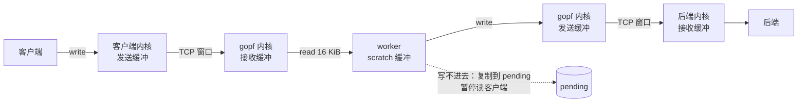

对应代码：`src/worker.zig:287` 的 `forwardReady` 是整条转发路径的核心，第 5.5 节会逐行拆解。

### 2.7 关闭、FIN 和半关闭

正常关闭时，TCP 两个方向各发一个 FIN。

1. A 发 FIN，表示"我没有数据要发了"。
2. B 读完 FIN 之前的数据，下一次读取返回 0。
3. B 还可以继续往 A 发数据（A 的读方向还开着）。
4. B 也发 FIN。
5. 双方都读到 EOF 后，两个数据方向均已结束。内核仍可能保留一段 `TIME_WAIT` 状态。

**半关闭**就是只关一个方向：`shutdown(fd, SHUT_WR)`。内核会在已排队的字节之后发送 FIN，fd 的读取方向仍然开放。

为什么代理必须理解半关闭？看一个 HTTP 例子：

```text
客户端：发完请求，shutdown(WR)   →  后端读到请求和 FIN
后端：处理完，发响应，再 FIN      →  客户端读到响应和 FIN
```

如果 gopf 一看到客户端 FIN 就把后端的 fd 整个 `close`，后端的响应就丢了。正确做法是：客户端 EOF 时，只对后端 `shutdown(WR)`；后端还能往回写，等后端也 EOF，才关闭整条连接。

后端也可以先结束自己的写方向。例如后端发完问候语并发出 FIN，仍可以等待客户端随后发来的数据。这时 gopf 只对客户端调用 `shutdown(WR)`，客户端仍能向后端写入。端到端测试覆盖了这条路径（`src/integration.zig:28`）。

已建立的连接也可能被 RST 重置，这时 `read` 可能返回 `ECONNRESET`。gopf 遇到这种错误会直接销毁连接（`src/worker.zig:266`）。

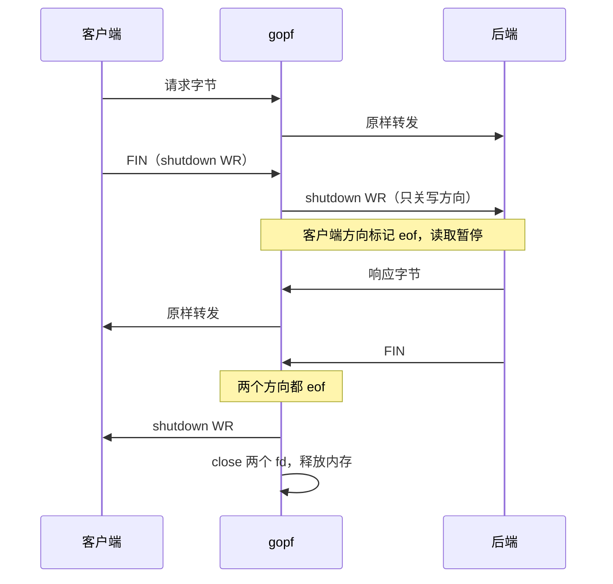

对应代码：`src/sys.zig:175` 的 `shutdownWrite`；`src/worker.zig:301` 处理读到的 0 字节；`src/worker.zig:275` 判断两个方向都 EOF 后移除连接。

### 2.8 keepalive：发现死连接

如果客户端机器断电、网线被拔，TCP 连接不会有 FIN。两端都不知道对方没了，fd 一直占着。**keepalive** 让内核定期发探测包，连续没响应就判定连接死亡，把 fd 标成错误。

系统的默认探测时间可以配置。gopf 在每条代理连接的两端都打开 keepalive，采用以下设置。

- 空闲 60 秒后开始探测。
- 探测间隔 60 秒。

注意不同系统的常量名不同：Linux 用 `TCP_KEEPIDLE` 表示空闲时间，macOS 用 `TCP_KEEPALIVE`。`src/sys.zig:251` 用条件表达式处理了这个差异。

对应代码：`src/sys.zig:248` 的 `configurePeer`，accept 和 connect 之后都会调用。

### 2.9 事件通知：poll、epoll、kqueue

最朴素的服务器是"一条连接一个线程"：线程阻塞在 `read` 上，来数据就醒。问题是 10000 条连接就要 10000 个线程，每个线程都要预留栈并占用内核资源，大量线程还会增加调度和切换开销。

另一种模型是**就绪通知**：把一个或多个 fd 注册给内核，然后问内核"这些 fd 里哪些现在可读/可写？"。一个线程就能管几千条连接。

三代接口：

| 接口 | 平台 | 特点 |
| --- | --- | --- |
| `select` | 所有 Unix | fd 集合有上限（通常 1024），每次调用都要把集合拷进内核 |
| `poll` | 所有 Unix | 用数组代替位图，没有 1024 限制，但仍要每次拷贝 |
| `epoll` | Linux | 兴趣列表常驻内核，`epoll_wait` 只返回就绪的事件，适合大量 fd |
| `kqueue` | BSD、macOS | 思路类似 epoll，用"过滤器"（filter）表示读/写事件 |

gopf 在 Linux 上用 epoll，在 macOS 上用 kqueue，用 `src/poller.zig` 把两者包成同一个接口。

**水平触发（level-triggered）**：只要条件还成立，每次等待都会再次通知。比如接收缓冲里还有数据没读完，`epoll_wait` 下次还会返回这个 fd 可读。gopf 依赖这个语义。每次处理完连接事件会重新计算关注的读写事件，只有兴趣变化才更新注册。

epoll 和 kqueue 都允许在事件里带一个用户数据（epoll 的 `data.u64`，kqueue 的 `udata`）。gopf 用它存一个 64 位 **token**，从 token 反推是哪个连接的哪一端。token 的设计见第 6.5 节。

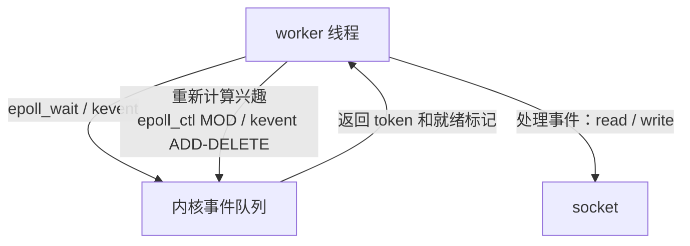

对应代码：`src/poller.zig:20` 的 `Poller`，`src/worker.zig:162` 的事件循环。

### 2.10 DNS：域名怎么变成 IP

配置里写 `localhost:9001` 或 `backend.example.com:9001` 时，程序需要把域名解析成 IP。`getaddrinfo` 做这件事，返回一个链表，可能包含多个地址（IPv4、IPv6、同一个域名的多个 IP）。

解析可能阻塞：要读 `/etc/hosts`、可能发 DNS 查询、等网络超时。如果放在事件循环里做，一次慢解析会卡住所有连接。

gopf 的策略是：**只在启动和重载时解析**。`Config.parse` 把每个正权重后端解析出的 IPv4 和 IPv6 地址存起来（`src/config.zig:61`），运行时只做非阻塞 connect。代价是重载时解析也会阻塞接入线程（见 9.1 的限制）。

`resolve` 的 `passive` 参数用于监听：`passive=true` 会设置 `getaddrinfo` 的 `AI_PASSIVE` 标志，host 为空表示通配地址，可以绑 `0.0.0.0` 或 `::`。后端解析用 `passive=false`，而且禁止端口 0（`src/sys.zig:40`）。

对应代码：`src/sys.zig:45` 的 `resolve`，`src/config.zig:58` 的零权重分支（只校验语法、不解析 DNS），`src/sys.zig:22` 的地址拆分。

### 2.11 信号：异步打断和 self-pipe 技巧

信号是内核发给进程的异步通知。比如 `kill -HUP <pid>` 发 `SIGHUP`，终端里按 Ctrl-C 发 `SIGINT`。

信号处理函数在一个很受限的环境里运行：它可能打断任何代码，包括正在 `malloc` 或 `printf` 的代码。所以处理函数里**只能调用 async-signal-safe 的函数**（`write` 可以，`malloc`、`printf`、`free` 不行），否则可能死锁或崩溃。

常见的解法叫 **self-pipe trick**：

1. 创建一个管道。
2. 信号处理函数只做两件事：设置一个原子标志，往管道写 1 个字节。
3. 主循环把管道读端放进 `poll`。管道可读就说明有信号，这时才在主循环里做真正的工作（读配置、打印状态）。

gopf 的实现：

- `onSignal`（`src/main.zig:228`）把对应位 `fetchOr` 进 `pending_signals`，然后写 wake pipe。
- 接入线程 `poll` 同时等 wake pipe 和监听 fd（`src/main.zig:129`）。
- 醒来后 `swap(0)` 一次性取走所有标志位，按位处理（`src/main.zig:137`）。

位掩码记录每类待处理信号。相同信号可合并成一次处理，`swap` 把取标志和清零合成一个原子动作。停机信号优先，接入线程此时直接退出循环。

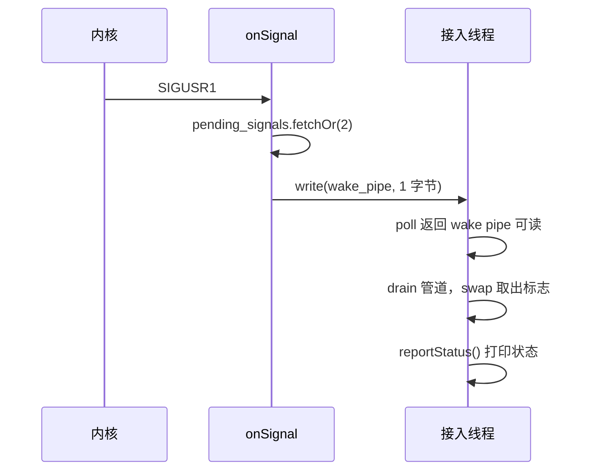

`sigaction` 安装四个信号，没有设置 `SA_RESTART`。这意味着系统调用可能被信号打断并返回 `EINTR`。gopf 在 `read`、`write`、`accept`、`epoll_wait`、`kevent` 里都重试了 `EINTR`（`src/sys.zig:118`、`src/sys.zig:155`、`src/sys.zig:168`、`src/poller.zig:113`、`src/poller.zig:136`）；`std.posix.poll` 内部也会自动重试（这是 Zig 标准库的行为，不是 gopf 写的）。

### 2.12 socket 选项清单

| 选项 | 作用 | 位置 |
| --- | --- | --- |
| `SO_REUSEADDR` | 允许在系统规定的条件下复用本地地址，便于服务重启 | `src/sys.zig:87` |
| `SO_KEEPALIVE` | 打开 TCP keepalive | `src/sys.zig:250` |
| `TCP_KEEPIDLE` / `TCP_KEEPALIVE` | 空闲多久开始探测（Linux / macOS 名字不同） | `src/sys.zig:251` |
| `TCP_KEEPINTVL` | 探测间隔 | `src/sys.zig:253` |
| `SO_NOSIGPIPE` | macOS 上禁止向已关闭连接写时发 `SIGPIPE` | `src/sys.zig:249` |
| `MSG_NOSIGNAL` | Linux 上 `send` 的等价手段 | `src/sys.zig:163` |
| `SOCK_NONBLOCK` | 创建 socket 时直接设为非阻塞 | `src/sys.zig:232` |
| `SOCK_CLOEXEC` / `FD_CLOEXEC` | 成功执行 `exec` 时自动关闭 fd，避免传给新程序 | `src/sys.zig:232`、`src/sys.zig:245` |
| `SO_ERROR` | 读取异步 connect 的最终结果 | `src/sys.zig:145` |

`SIGPIPE` 值得单独说：向写方向已断开的 socket 写入时，系统可能报告 `EPIPE` 并发出 `SIGPIPE`。该信号的默认动作是终止进程。所以网络程序要么忽略 `SIGPIPE`，要么在每次写时用 `MSG_NOSIGNAL`。gopf 选了后者，在 Linux 上给 `send` 加 `MSG_NOSIGNAL`；macOS 没有这个标志，改用 `SO_NOSIGPIPE` 选项。

### 2.13 概念到代码的映射

| 网络概念 | gopf 里的位置 |
| --- | --- |
| 地址字符串解析 | `src/sys.zig:22` `splitAddress` |
| 域名解析 | `src/sys.zig:45` `resolve` |
| 监听 | `src/sys.zig:84` `listen` |
| 接受连接 | `src/sys.zig:105` `accept` |
| 拨号 | `src/sys.zig:130` `connect`、`src/sys.zig:142` `finishConnect` |
| 读 | `src/sys.zig:150` `read` |
| 写 | `src/sys.zig:162` `write` |
| 半关闭 | `src/sys.zig:175` `shutdownWrite` |
| 事件等待 | `src/poller.zig:84` `wait` |
| 兴趣注册 | `src/poller.zig:45` `update` |
| 背压 | `src/worker.zig:287` `forwardReady` |
| 信号 | `src/main.zig:217` 安装、`src/main.zig:228` 处理 |

---

## 3. Zig 与 C 基础：读懂这份代码需要的最小知识

这一章不是 Zig 教程，只讲这份代码用到的语法。每个语法点都配了项目里的真实片段。

### 3.1 构建系统：`build.zig` 是一个 Zig 程序

很多语言用 Makefile 或配置文件描述构建。Zig 不一样：`build.zig` 本身就是一段 Zig 代码，`zig build` 会先编译它，再执行里面的 `build` 函数。

```zig
// build.zig:3
pub fn build(b: *std.Build) void {
    const target = b.standardTargetOptions(.{});       // ← 目标平台，默认本机
    const optimize = b.standardOptimizeOption(.{});    // ← 优化级别，默认 Debug

    const exe = b.addExecutable(.{                     // ← 声明一个可执行文件
        .name = "gopf",
        .root_module = b.createModule(.{
            .root_source_file = b.path("src/main.zig"), // ← 入口文件
            .target = target,
            .optimize = optimize,
            .link_libc = true,                          // ← 链接目标平台的 libc
        }),
    });
    b.installArtifact(exe);                             // ← 装到 zig-out/bin/

    const tests = b.addTest(.{                          // ← 另一个编译目标：测试
        .root_module = b.createModule(.{
            .root_source_file = b.path("src/tests.zig"),
            .target = target,
            .optimize = optimize,
            .link_libc = true,
        }),
    });
    const run_tests = b.addRunArtifact(tests);
    b.step("test", "Run configuration and TCP forwarding tests")
        .dependOn(&run_tests.step);                     // ← zig build test 时运行
}
```

需要知道的四件事：

1. **默认步骤**是安装可执行文件。`zig build` 等价于编译并安装，产物在 `zig-out/bin/gopf`。
2. **`zig build test`** 是自定义步骤，编译 `src/tests.zig` 并运行。
3. **`-Doptimize=ReleaseFast`** 覆盖优化级别。Zig 有四个常用级别：`Debug`（默认，带完整安全检查）、`ReleaseSafe`（优化但仍保留安全检查）、`ReleaseFast`（追求速度，关闭安全检查）、`ReleaseSmall`（追求体积）。性能测试用的是 `ReleaseFast`。
4. **缓存**放在 `.zig-cache/`（本地）和全局缓存目录。第一次构建通常较慢，后续构建能复用有效的缓存结果。如果全局缓存目录没有写权限，可以加 `--cache-dir` 和 `--global-cache-dir` 指定到可写位置。

`link_libc = true` 很关键：这份代码直接调用 `socket`、`epoll_wait`、`getaddrinfo` 这些 C 函数，没有 libc 就链接不上。

### 3.2 文件即模块

Zig 没有头文件，也没有包声明。一个 `.zig` 文件有自己的命名空间，可用 `@import` 引入。

```zig
// src/main.zig:1
const std = @import("std");
const sys = @import("sys.zig");
const Config = @import("config.zig").Config;   // ← 导入后在文件内起个名字
```

- `pub fn`、`pub const` 声明的内容才能被别的文件访问。
- 没加 `pub` 的只在当前文件可见，比如 `src/config.zig:6` 的 `Host`、`src/worker.zig:20` 的 `Endpoint`。
- `@import("builtin")` 是特殊情况：它提供编译器信息，比如当前目标系统。

依赖关系很直接：`main` 依赖 `config`、`sys`、`worker`；`worker` 依赖 `poller`、`sys`；`config` 依赖 `sys`。没有循环依赖。

### 3.3 变量、类型和整数

```zig
const connection_budget = 16_384;  // ← 编译期常量，类型是 comptime_int，可参与任意运算
var next_worker: usize = 0;        // ← 可变变量，类型 usize（指针宽度无符号整数）
const pick = random.intRangeLessThan(i64, 0, self.total_weight); // ← 类型显式给出
```

- `const` 只表示"这个绑定不能重新赋值"；它指向的内存能不能改，由类型决定：`*const T` 不能改，`*T` 可以改。
- 整数类型必须写宽度：`u8`、`u16`、`u32`、`u48`、`u64`、`i64`、`usize`。`usize` 是长度和下标惯用类型。
- 溢出行为分模式：Debug 和 ReleaseSafe 下，`+` 溢出会 panic；ReleaseFast 下是未定义行为。所以计数器用饱和加法 `+|`（`src/main.zig:158` 的 `self.total +|= 1`），权重求和用带检查的 `std.math.add`（`src/config.zig:57`）。
- `@intCast` 保持整数的数值并转换类型。目标类型装不下时属于非法行为，安全模式下会报错。需要截掉高位时用 `@truncate`。`@as(i64, 0)` 给字面量指定类型，`@bitSizeOf(u16)` 取类型的位宽。

Zig 的 `@` 开头都是**内建函数**，由编译器直接处理，相当于 C 的编译器扩展，但更统一。这份代码用到的有：`@import`、`@intCast`、`@ptrCast`、`@memcpy`、`@bitCast`、`@fromBackingInt`、`@bitSizeOf`、`@sizeOf`、`@min`、`@max`、`@compileError`。

### 3.4 数组和切片

```zig
var batch: [128]events.Event = undefined;   // ← 固定长度数组，在栈上
var scratch: [chunk_size]u8 = undefined;    // ← 16 KiB 的栈缓冲
...
for (batch[0..count]) |event| { ... }       // ← 切片：指针 + 长度
```

| 写法 | 含义 |
| --- | --- |
| `[128]T` | 长度 128 的数组，长度是类型的一部分 |
| `[]T` | 切片：指向一段连续 T 的指针 + 长度，可写 |
| `[]const u8` | 只读字节切片，常用作字符串 |
| `&.{}` | 可按上下文转换为空切片，用作"没有数据" |
| `buf[0..n]` | 子切片；越界在安全模式下 panic |
| `dupeSentinel(u8, text, 0)` | 复制成以 0 结尾的字符串，给 C 函数用 |

Zig 常用 `[]const u8` 表示文本，带长度。C 字符串 API 要求末尾有一个 0。Zig 可以用 `[:0]const u8` 表示带这个保证的切片。`src/sys.zig:47` 的 `dupeSentinel` 为普通切片复制出以 0 结尾的版本。

### 3.5 可选值：`?T`

`?T` 表示"要么是 T，要么是 null"。这份代码用它表达"现在没有"：

```zig
// src/sys.zig:156
.AGAIN => return null,          // ← read 现在没有数据，不是错误

// src/main.zig:157
const client = try sys.accept(self.listener) orelse return;  // ← 没有新连接就结束本批
```

两种解包方式：

- `orelse 默认值`：为 null 时给一个替代值。
- `if (value) |v| { ... }`：有值时进入分支，`v` 是非可选类型。

对比 C：C 常用 `NULL` 指针表示没有值，解引用空指针属于未定义行为。Zig 把"可能没有"写进类型，编译器强制你处理。

### 3.6 错误：`!T`、`try`、`catch`、`errdefer`

`!T` 是**错误联合**：成功时是 `T`，失败时是一个错误值。Zig 没有异常。

```zig
// src/config.zig:16
pub fn load(allocator: Allocator, io: std.Io, path: []const u8) !Config {
    const text = try std.Io.Dir.cwd().readFileAlloc(io, path, allocator, .limited(16 * 1024 * 1024));
    defer allocator.free(text);
    return parse(allocator, text);   // ← parse 的错误原样向上传递
}
```

- `try expr`：expr 出错时立即从当前函数返回这个错误。
- `catch |err| { ... }`：自己处理错误。可以返回值、可以 `return error.X`、可以 `switch` 区分。
- 返回类型写成 `!T` 时由编译器推断错误集合，也可以写出具体的错误集合。`anyerror` 表示任意错误（`src/main.zig:206` 用了它）。
- `errdefer` 在函数从当前作用域返回错误时执行，可回滚已经完成的分配。

Unix 的很多 C 接口约定失败时返回 `-1`，调用者再查线程局部的 `errno`。Zig 把错误变成返回值的一部分，类型系统要求你处理，或者显式 `catch {}` 忽略。

这份代码里的错误分两类：

- **可恢复、按连接处理**：读写失败、拨号失败、预算超限。worker 记录日志、销毁这条连接，不影响别的连接。
- **启动失败或监听失效**会结束进程。运行中单个 worker 的事件等待失败时，该 worker 清理自己并退出，接入线程和其余 worker 继续运行（`src/worker.zig:151`）。

### 3.7 `defer`：把清理写在资源旁边

```zig
// src/main.zig:37
var wake_pipe = try sys.WakePipe.init();
defer wake_pipe.deinit();          // ← 函数返回时自动关闭两个 fd
```

`defer` 在**离开当前作用域**时执行，多个 `defer` 按后进先出顺序执行。它替代了 C 里"goto cleanup"的写法，而且不会忘。

函数从当前作用域返回错误时，才会执行这里注册的 `errdefer`。例如 `src/config.zig:33`：

```zig
var arena = std.heap.ArenaAllocator.init(allocator);
errdefer arena.deinit();     // ← 解析失败时释放 arena；成功时由调用者 deinit
```

一个常见错误是 `defer` 了一个即将失效的指针。铁律：`defer` 里用的值必须在作用域结束时仍然有效。

### 3.8 结构体、方法和默认值

```zig
// src/worker.zig:25
const Direction = struct {
    pending: ?[]u8 = null,   // ← 字段默认值
    offset: usize = 0,
    eof: bool = false,

    fn canRead(self: Direction) bool {   // ← 结构体内的函数可用点号传入第一个参数
        return !self.eof and self.pending == null;
    }
};
```

- Zig 没有类和继承，用结构体加函数组合。
- 方法第一个参数可以按值（`self: Direction`）或按指针（`self: *Worker`）。要修改字段就用指针。
- 上下文能推断结构体类型时，可用 `.{ .field = value }` 初始化。
- `undefined` 表示"先不初始化，我保证用之前会赋值"。用在栈缓冲和固定数组上。

这份代码里的核心结构体：`Worker`、`Connection`、`Direction`、`Endpoint`、`Job`、`Acceptor`、`Config`、`Address`。附录 C 有字段表。

### 3.9 分配器：内存必须有人负责

Zig 没有垃圾回收，所有动态内存都由显式分配器管理。分配器是一个带函数指针的接口，常见实现：

| 分配器 | 用途 | 项目中的位置 |
| --- | --- | --- |
| `std.heap.smp_allocator` | 多线程友好的通用分配器 | `src/main.zig:27` 主分配器 |
| `std.heap.ArenaAllocator` | 批量分配、一次性释放 | `src/config.zig:32` 配置和地址 |
| `std.testing.allocator` | 测试用，自动检测泄漏 | `src/integration.zig:11` 等 |

基本操作：

```zig
const buf = try allocator.alloc(u8, n);   // ← 分配 n 个字节
defer allocator.free(buf);                // ← 释放时传回同一个切片，长度在切片里

const copy = try allocator.dupe(u8, slice);   // ← 复制一份
const owned = try list.toOwnedSlice(allocator); // ← 把 ArrayList 变成切片
```

为什么 worker 要把没写完的数据 `dupe` 一份？因为读缓冲 `scratch` 是每个 worker 共用的一块栈内存，下一次 `read` 就会覆盖它。待写数据需要在下一次读取后仍然有效。这份实现使用 `dupe` 把待写部分复制到独立的堆缓冲（`src/worker.zig:312`）。

对应地，`freePending`（`src/worker.zig:342`）在数据写完或连接销毁时释放这块内存，同时从 `pending_bytes` 里扣掉。

### 3.10 标准库里用得最多的部分

| 模块 | 用途 | 项目中的例子 |
| --- | --- | --- |
| `std.json` | 解析 JSON | `src/config.zig:23` |
| `std.AutoHashMap` | 哈希表，id → 连接 | `src/worker.zig:70` |
| `std.ArrayList` | 动态数组 | `src/sys.zig:69` |
| `std.Thread` | 创建线程 | `src/worker.zig:94` |
| `std.atomic.Value` | 无锁原子变量 | `src/main.zig:15`、`src/worker.zig:61` |
| `std.Random` | 随机数和加权抽样 | `src/main.zig:67`、`src/config.zig:73` |
| `std.fmt` | 数字转字符串 | `src/sys.zig:50` |
| `std.mem` | 字节操作、比较、查找 | `src/sys.zig:23` |
| `std.ascii` | 字符判断 | `src/sys.zig:37` |
| `std.math` | 检查溢出 | `src/config.zig:57` |
| `std.posix` | POSIX 封装（poll、fd_t） | `src/main.zig:134` |
| `std.c` | 调用 libc | `src/sys.zig` 的 socket 和地址解析，`src/poller.zig` 的事件接口 |
| `@import("builtin")` | 编译目标信息 | `src/sys.zig:2` |

`std.posix` 的 `poll` 等封装会把错误转成 Zig 错误值，底层依目标平台和链接选项而定。`std.c` 提供 libc 声明，以及读 `errno` 等辅助函数。`sys.zig` 和 `poller.zig` 直接调用 `std.c`，分别处理 socket 与平台事件接口的返回值。

### 3.11 comptime：编译期决定的分支

Zig 的 `comptime` 让代码在编译期求值。这份代码只用到了最朴素的两种：

```zig
// src/sys.zig:4
const is_linux = builtin.os.tag == .linux;   // ← 编译期常量

// 用 if 做条件编译：条件在编译期已知时，只保留命中的分支
const accepted = if (is_linux)
    c.accept4(fd, null, null, c.SOCK.NONBLOCK | c.SOCK.CLOEXEC)
else
    c.accept(fd, null, null);
```

```zig
// src/poller.zig:24
const fd = switch (os) {
    .linux => c.epoll_create1(linux.EPOLL.CLOEXEC),
    .macos => c.kqueue(),
    else => @compileError("gopf supports Linux and macOS"),  // ← 其它平台编译失败
};
```

对比 C 的 `#ifdef`：Zig 用普通的 `if` 和 `switch` 表达编译期分支。条件在编译期已知时，编译器只分析选中的分支。`@compileError` 在编译期产生一条自定义错误，比运行到一半才发现平台不支持要好。

### 3.12 线程、原子和互斥锁

gopf 的并发模型很简单：**连接状态只属于一个 worker 线程**，线程通过 Job 队列交接连接，并共享唤醒管道、停止标志和计数器。

创建线程：

```zig
// src/worker.zig:92
pub fn start(self: *Worker) !void {
    std.debug.assert(self.thread == null);
    self.thread = try std.Thread.spawn(.{}, run, .{self});  // ← 新线程执行 run(self)
}
```

原子变量：

```zig
// src/worker.zig:61
stopping: std.atomic.Value(bool) = .init(false),
active: std.atomic.Value(usize) = .init(0),
```

- `stopping` 用 `.release` 写、`.acquire` 读，保证"设置停止"之前的修改对读到 true 的线程可见。
- `active` 只做计数，用 `.monotonic` 就够，因为不需要用它同步其它数据。

互斥锁（0.17 的 IO 感知版本）：

```zig
// src/worker.zig:134
self.queue_lock.lockUncancelable(self.io);
defer self.queue_lock.unlock(self.io);
```

`lockUncancelable` 表示等待锁的过程不可取消，因此不需要处理"取消"错误。

跨线程的规则可以总结成一句话：**队列用锁，计数用原子，连接本体不共享**。第 6.6 节会讲队列的完整时序。

### 3.13 C 互操作：`std.c` 到底在做什么

Unix 的常用 socket 和文件接口由 libc 以 C 调用约定暴露。Zig 标准库提供了这份代码需要的声明，可以直接调用。

需要认识的 C 概念：

| C 概念 | 在 Zig 里的样子 | 项目中的例子 |
| --- | --- | --- |
| 头文件声明 | `std.c` 已经声明好了，直接 `c.xxx` | `c.socket`、`c.bind` |
| 结构体 | `c.sockaddr`、`c.addrinfo`、`c.epoll_event` | `src/sys.zig:9` |
| 指针 | `*const c.sockaddr`、`[*]u8` | `src/sys.zig:13` |
| `NULL` | `null`（配合 `?*T`） | `src/sys.zig:58` |
| `memcpy` | `@memcpy` | `src/sys.zig:77` |
| 宏常量 | `c.AF.INET`、`c.SOCK.STREAM`、`c.EVFILT.READ` | 全文件 |
| `errno` | `c.errno(rc)` 读当前线程的 errno | `src/sys.zig:111` |
| 类型宽度 | `c_int`、`c_uint`、`c.socklen_t` | `src/poller.zig:59` |
| 调用约定 | `callconv(.c)` | `src/main.zig:228` 信号处理 |

几个具体例子：

**地址结构体**。C 的 socket API 用 `sockaddr` 家族。IPv4 是 `sockaddr_in`，IPv6 是 `sockaddr_in6`。为了统一，`bind`/`connect` 接收 `*const sockaddr` 加一个长度。gopf 用 `sockaddr.storage`（128 字节，足够放下所有家族）存地址，转换时强制转型：

```zig
// src/sys.zig:12
fn ptr(self: *const Address) *const c.sockaddr {
    return @ptrCast(&self.storage);   // ← 相当于 C 的 (struct sockaddr *)&storage
}
```

**errno**。许多 Unix C 接口失败时返回 `-1`，具体原因放在线程局部的 `errno` 里。`getaddrinfo` 等接口有自己的返回码，要按各自文档读取错误。Zig 的 `c.errno(rc)` 封装了这个约定：`rc == -1` 时读 errno 并转成 `c.E` 枚举，否则返回 `.SUCCESS`。

```zig
// src/sys.zig:105，示意 macOS 分支
const accepted = c.accept(fd, null, null);
switch (c.errno(accepted)) {
    .SUCCESS => { ... },
    .INTR => continue,      // ← 被信号打断，重试
    .AGAIN => return null,  // ← 没有新连接
    else => |err| return socketError(err),
}
```

这个写法很巧：`accept` 成功时返回 fd（非负整数），`c.errno` 看到不是 -1 就返回 `.SUCCESS`；失败时返回 -1，才去读 errno。

**以 0 结尾的字符串**。`getaddrinfo` 接受 C 字符串，调用者须保证结尾为 0。`src/sys.zig:47`：

```zig
const host = if (parts.host.len != 0) try allocator.dupeSentinel(u8, parts.host, 0) else null;
...
const rc = c.getaddrinfo(if (host) |name| name.ptr else null, service.ptr, &hints, &result);
```

**信号处理函数的调用约定**。`sigaction` 传入的处理函数须符合平台的 C 调用约定。用 `callconv(.c)` 声明该函数。

```zig
// src/main.zig:228
fn onSignal(sig: posix.SIG) callconv(.c) void { ... }
```

**在信号处理函数里保护 errno**。写管道可能改变 errno，而被打断的代码可能正要读 errno。`src/sys.zig:183` 先把 errno 存起来，函数结束再恢复：

```zig
const errno = c._errno();
const previous = errno.*;
defer errno.* = previous;
const byte = [_]u8{1};
while (c.errno(c.write(fd, &byte, byte.len)) == .INTR) {}
```

### 3.14 Zig 0.17 的 `std.Io` 出现在哪里

在这里，`std.Io` 是显式传入的 I/O 上下文。程序入口通过 `std.process.Init` 获取它。

```zig
// src/main.zig:18
pub fn main(init: std.process.Init) !void {
    ...
    const options = Options.parse(init.minimal.args) ...;  // ← 命令行参数
    var config = Config.load(allocator, init.io, options.config_path) ...;  // ← I/O 上下文
```

这份代码只在下面这些地方用了 `std.Io`：

| 用途 | 代码 |
| --- | --- |
| 读配置文件 | `src/config.zig:17` `std.Io.Dir.cwd().readFileAlloc(io, ...)` |
| 互斥锁 | `src/worker.zig:117` `lockUncancelable(self.io)` |
| 生成随机种子 | `src/main.zig:58` `init.io.random(...)` |
| 测试里的单调时钟 | `src/integration.zig:234` `std.Io.Clock.awake.now(testing.io)` |

网络收发没有走 `std.Io`，而是直接用 libc 的非阻塞 fd + epoll/kqueue。原因是 gopf 需要精确控制"哪个 fd 在等什么事件"，以及自定义的 token 映射；直接操作事件循环比套一层抽象更直观。这也是为什么 `link_libc = true`。

如果你在别的项目里看到 `std.Io` 的用法和这里不一样，很正常：0.17 的这套接口还在演进，以你本地标准库源码为准。

### 3.15 读 Zig 代码的技巧

1. **从入口开始**：`src/main.zig:18` 的 `main`，一行一行往下读，遇到不认识的函数跳进去。
2. **看类型签名**：`!` 表示可能失败，`?` 表示可能为空，`*` 表示指针。通过 `*const T` 可以读取数据。这三个符号能告诉你大部分控制流。
3. **`@` 开头是编译器内建**，去 Zig 语言参考查，不要当普通函数找。
4. **`defer` 是清理点**：想知道资源什么时候释放，搜 `defer` 和 `errdefer`。
5. **跨平台代码看 `if (is_linux)` 和 `switch (os)`**：两个分支通常只有系统调用名不同。
6. **不要用旧教程的 API**：0.11 时代的 `std.os`、`std.builtin.Type`、`std.Thread.Mutex` 名字在这份代码里已经变了。

### 3.16 速查表：看到这些写法怎么读

| 写法 | 读法 |
| --- | --- |
| `pub fn f(x: T) !U` | 公开函数，接收 T，返回 U 或一个错误 |
| `!void` | 不返回值，但可能失败 |
| `?T` | 可能有 T，也可能是 `null` |
| `try expr` | 执行 expr；出错就立刻把错误返回给调用者 |
| `expr catch \|err\| { ... }` | 出错时执行花括号里的处理 |
| `expr orelse fallback` | 为 `null` 时用 fallback |
| `if (maybe) \|v\| { ... }` | 非 `null` 时把值绑定到 `v` |
| `defer cleanup()` | 离开作用域时执行 cleanup |
| `errdefer cleanup()` | 只有因错误离开作用域时才执行 |
| `const x = ...` | 绑定不可重新赋值 |
| `var x = ...` | 绑定可重新赋值 |
| `[]const u8` | 只读字节切片，通常当字符串 |
| `[]u8` | 可写字节切片 |
| `&.{}` | 空切片常量 |
| `undefined` | 先不初始化，用前必须赋值 |
| `unreachable` | 逻辑上不可能到这里；安全模式下会 panic |
| `@intCast(x)` | 整数类型转换，安全模式下检查范围 |
| `@ptrCast(p)` | 指针类型转换，相当于 C 的强制转型 |
| `@memcpy(dst, src)` | 内存复制，相当于 C 的 `memcpy` |
| `switch (x) { .a => ..., else => ... }` | 模式匹配；枚举、错误、可选值都能用 |
| `std.debug.assert(cond)` | 不成立就 panic；ReleaseFast 下被移除 |
| `std.log.warn("...", .{})` | 带级别的日志，默认输出到 stderr |
| `std.debug.print("...", .{})` | 直接打印到 stderr，不经过日志级别过滤 |

---

## 4. 全局架构

### 4.1 分层视角

gopf 的职责可以分成四层。入口和接入职责同在 `main.zig`，配置与连接转发各有自己的模块。

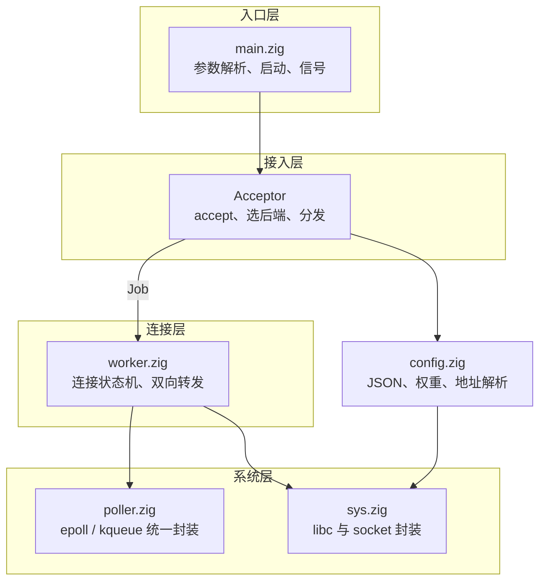

| 层 | 职责 | 不该做的事 |
| --- | --- | --- |
| 入口层 | 解析命令行、加载配置、创建资源、装信号、启动线程 | 不处理连接数据 |
| 接入层 | 接受连接、选后端、把连接交给 worker、处理信号 | 不读写连接数据 |
| 连接层 | 拨号、注册事件、双向搬运、半关闭、背压、销毁连接 | 不碰配置文件，不解析 JSON |
| 系统层 | 把 libc 的错误码翻译成 Zig 错误、屏蔽平台差异 | 不包含业务逻辑 |

修改事件通知的系统接口，从 `poller.zig` 入手。修改连接调度、转发或背压，从 `worker.zig` 入手。配置格式由 `config.zig` 处理。

### 4.2 进程与线程模型

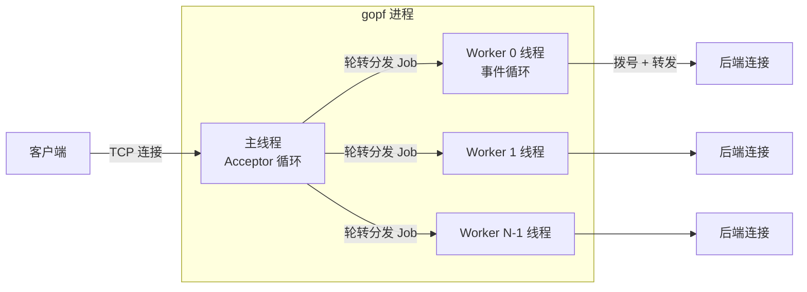

默认启动 `min(逻辑 CPU 数, 16)` 个 worker（`src/main.zig:82`），可以用 `-workers` 覆盖。接入循环运行在主线程。

主线程负责 accept、选后端和入队，也处理重载与状态查询。worker 独立推进拨号和双向转发。每条新连接要经过一次带锁的队列交接。队列从空变非空时，主线程唤醒 worker。

### 4.3 启动时序

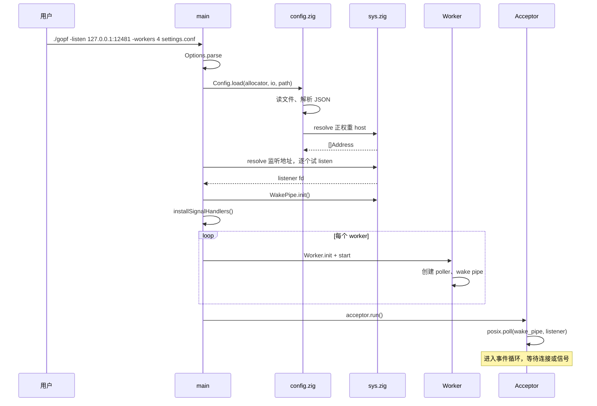

参数错误和初始配置错误会分别调用 `std.process.exit(2)` 和 `std.process.exit(1)`。后续资源初始化失败时，`main` 返回错误，已登记的 `defer` 随之执行。退出码见 8.5。

### 4.4 模块依赖

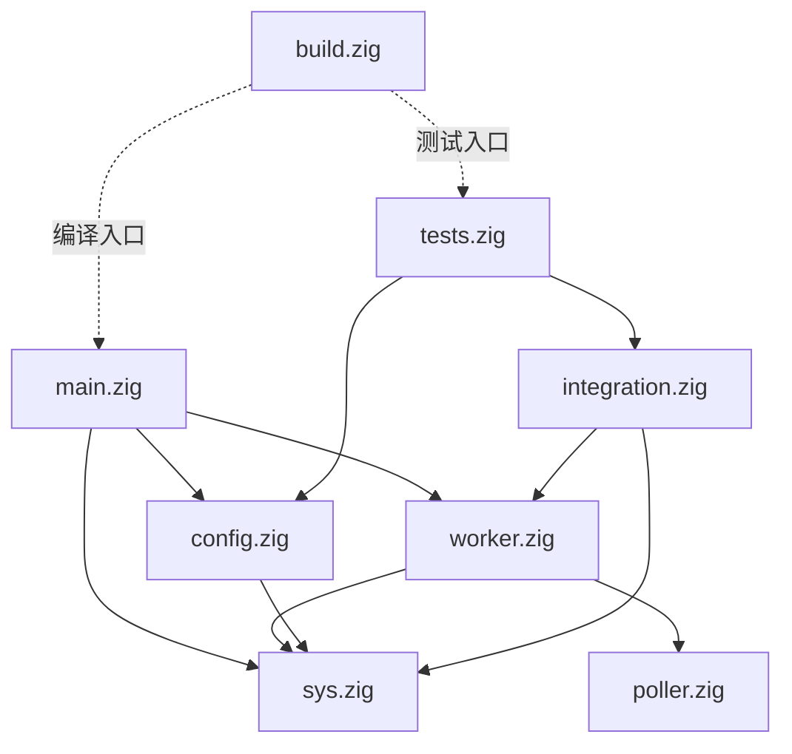

`main`、`config`、`worker` 和集成测试直接使用 `sys.zig`。`worker.zig` 通过 `poller.zig` 获取网络事件。测试使用独立的构建入口。

### 4.5 代码地图

| 文件 | 行数 | 一句话职责 | 关键符号 |
| --- | ---: | --- | --- |
| [src/main.zig](src/main.zig) | 238 | 参数解析、资源创建、接入循环、信号 | `Options`、`Acceptor`、`installSignalHandlers` |
| [src/worker.zig](src/worker.zig) | 364 | 每个线程的事件循环与连接状态机 | `Worker`、`Connection`、`Direction`、`forwardReady` |
| [src/sys.zig](src/sys.zig) | 285 | socket、管道和相关 libc 错误映射 | `Address`、`resolve`、`listen`、`accept`、`connect`、`WakePipe` |
| [src/poller.zig](src/poller.zig) | 153 | epoll/kqueue 的统一接口 | `Poller`、`Interest`、`Event` |
| [src/config.zig](src/config.zig) | 145 | JSON 配置、校验、加权选择 | `Config`、`choose`、`Host` |
| [src/integration.zig](src/integration.zig) | 251 | 四个端到端测试和测试夹具 | `Peers`、`expectData` |
| [src/tests.zig](src/tests.zig) | 4 | 测试入口 | `test { ... }` |
| [build.zig](build.zig) | 28 | 构建与测试步骤 | `build` |

推荐阅读顺序：`main` 的 `main` 函数 → `Acceptor.run` → `worker.zig` 的 `run` 和 `processEvent` → `forwardReady` → `sys.zig` 对应函数 → `poller.zig`。配置和测试可以最后读。

### 4.6 数据所有权：谁分配、谁释放

这是读这份代码最容易迷糊的地方。先把规则列清楚：

| 对象 | 分配者 | 所有者 | 释放者 | 跨越线程？ |
| --- | --- | --- | --- | --- |
| 监听 fd | `openListener` | `main` | `main` 的 `defer` | 否 |
| 配置 `Config` | `Config.load` | `main` 持有，`Acceptor` 借用 | 重载时 `Acceptor` 释放旧代，退出时 `main` 释放当前代 | 否 |
| host 地址切片 | `Config.parse` 的 arena | `Config` | `Config.deinit` | 否 |
| worker 数组 | `main` | `main` | `main` 在各 worker 线程退出后释放 | 是，各线程访问对应的 worker 元素 |
| `Job` | `Acceptor.dispatch` 按值构造 | 提交成功后由队列管理 | 取出后把 fd 和备用地址交给连接，取消排队时清理资源 | 是（按值入队） |
| 客户端 fd | `sys.accept` | acceptor → 队列 → worker | 接入失败由 acceptor 关闭，入队后由 worker 清理 | 是（移交） |
| fallback 地址切片 | `Acceptor.dispatch` 的 `dupe` | acceptor → 队列 → 拨号中的连接 | 提交失败由 acceptor 释放，提交后由 worker 在弃队、拨通或销毁时释放 | 是（移交） |
| 后端 fd | `sys.connect` | `Connection` | `finishDial` 在换地址前关闭旧 fd，`destroyConnection` 关闭仍持有的 fd | 否 |
| `pending` 缓冲 | `forwardReady` 的 `dupe` | `Direction` | `freePending` | 否 |
| `scratch` 读缓冲 | 栈上 | `Worker.run` | 随函数返回 | 否 |

1. **提交成功才移交 fd 和 fallback**。`submit` 返回 false 时，acceptor 继续试下一个 worker。全都拒绝时，`dispatch` 释放 fallback，`acceptBatch` 关闭客户端 fd（`src/main.zig:155`、`src/main.zig:167`）。
2. **Job 带着独立的拨号数据**。首选地址按值复制，备用地址按需复制成独立切片。已经入队和正在拨号的连接仍按原来的选择推进。
3. **`Connection` 按值存在哈希表里**。worker 处理事件时按 id 调用 `getPtr`，只在这次处理内使用指针。连接表会扩容，下一次事件重新查找。
4. **`active` 统计已交给 worker 的连接**。成功入队时加一，`discardJobs` 和 `destroyConnection` 分别为未出队 Job 和已出队连接减一（`src/worker.zig:127`、`src/worker.zig:143`、`src/worker.zig:351`）。
5. **每代配置用一个 arena**。`Config.deinit` 一次释放该代的 host 列表和解析后的地址。

### 4.7 三条主要数据路径

**路径 A：接入**

```text
内核 accept 队列
  → Acceptor.run 中的 poll 报告 listener 可读
  → sys.accept 拿到 client fd（非阻塞）
  → Config.choose 选后端地址
  → 轮转选 worker
  → Worker.submit 成功，移交 Job
  → 队列原本为空时写 wake pipe
```

**路径 B：转发**

```text
epoll/kqueue 报告某个 fd 可读
  → worker 读最多 16 KiB 到 scratch
  → 写到对端 fd
  → 写完了：结束
  → 没写完：复制剩余到 pending，暂停该方向读取
  → 对端变可写：从 pending 继续写
  → 写完：释放 pending，恢复读取
```

**路径 C：关闭**

```text
某方向 read 返回 0（FIN）
  → 标记 eof，对 peer shutdown(WR)
  → 另一个方向继续工作
  → 两个方向都 eof
  → close 两个 fd、释放 pending、减 active、从哈希表删除
```

异常情况（读写出错、预算超限、拨号全部失败）直接跳到"销毁连接"，不等另一个方向。

### 4.8 关键设计决策

这张表回答"为什么代码长这样"。每条都可以在后面的章节找到细节。

| 决策 | 理由 | 代价 |
| --- | --- | --- |
| 一个 acceptor 线程 + N 个 worker 线程 | 接入和转发分别调度，多个 worker 可并行转发 | 多一次跨线程移交 |
| 每个 worker 一个事件循环，连接不迁移 | 连接状态不需要锁；缓存友好 | 负载不均时无法搬连接 |
| 每个 worker 复用一块 16 KiB 读缓冲 | 10000 条连接不需要 10000 块常驻读缓冲；只有真正积压的连接才分配 pending | 一次只能读 16 KiB；跨事件保留数据要复制 |
| 写不完就停读，加 worker 级 pending 预算 | 限制用户态积压分配 | 当前连接超过预算时直接关闭 |
| token = 连接 id + 端点 + 重试次数 | 用 64 位整数就能从内核事件找回连接 | 编码逻辑不直观，id 上限 2^48 |
| 拨号只做地址级 fallback | 后端有多个 IP 时能自动换 | 不做整条连接的重试排队 |
| 配置在启动和重载时解析 DNS | worker 无需同步解析域名 | 读文件和解析期间暂停接入 |
| 配置用 arena | 代码简单，释放一次搞定 | 将拨号数据移交给 worker 时要复制备用地址 |
| 日志直接写 stderr | 日志可由运行环境直接收集 | 同步写日志可能拖慢接入或转发 |

---

## 5. 模块详解

这一章逐个文件拆解。每个模块按同样的结构讲：职责、对外接口、关键代码、错误路径、容易踩的坑。

### 5.1 构建与测试入口

`build.zig` 在 3.1 已经讲过，这里补充测试的组织方式。

`src/tests.zig` 只有四行：

```zig
test {
    _ = @import("config.zig");
    _ = @import("integration.zig");
}
```

Zig 的测试是"编译到测试二进制里的 `test` 块"。这个根测试块本身算一个测试，导入的两个模块里的 `test` 块也会被收集。所以 `zig build test` 实际跑：

| 来源 | 测试数 | 内容 |
| --- | ---: | --- |
| `src/tests.zig` 的根 `test` 块 | 1 | 只负责把模块拉进来 |
| `src/config.zig` | 3 | 大小写与权重、空配置、非法配置 |
| `src/integration.zig` | 4 | 两个半关闭方向、背压、1 MiB 数据 |
| 合计 | 8 | |

`settings.conf` 是配置示例，只有一条后端：

```json
{
  "hosts": [
    { "addr": "127.0.0.1:18091", "weight": 100 }
  ]
}
```

### 5.2 `config.zig`：配置从文件到可用的后端列表

#### 职责

把 JSON 文本变成一组"后端地址 + 权重"，并提供一个按权重随机选择的方法。它不关心连接，也不关心事件循环。

#### 数据结构

```zig
// src/config.zig:6
const Host = struct {
    addresses: []const sys.Address,  // ← 一个 host 解析出的所有 IP
    weight: i64,                     // ← 权重，非负
};

// src/config.zig:11
pub const Config = struct {
    arena: std.heap.ArenaAllocator,  // ← 所有配置内存都从这里出
    hosts: []const Host,
    total_weight: i64,               // ← 所有权重之和，0 表示没有可用后端
};
```

`Host` 没有 `pub`，所以别的文件不能声明这个类型，但可以读 `cfg.hosts.len`。这是 Zig 的可见性规则：类型名私有，字段值仍可通过已公开的值访问。

#### 加载流程

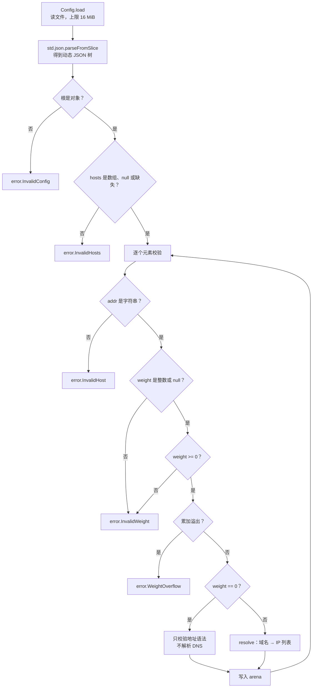

#### 关键代码

**读文件**（`src/config.zig:16`）：

```zig
pub fn load(allocator: Allocator, io: std.Io, path: []const u8) !Config {
    const text = try std.Io.Dir.cwd().readFileAlloc(io, path, allocator, .limited(16 * 1024 * 1024));
    defer allocator.free(text);
    return parse(allocator, text);
}
```

`.limited(16 MiB)` 是防御措施：配置写错指向了一个大文件时，不会把内存吃光。

**解析 JSON**（`src/config.zig:22`）：

```zig
const json = try std.json.parseFromSlice(std.json.Value, allocator, text, .{
    .duplicate_field_behavior = .use_last,   // ← 重复字段以最后一个为准
});
defer json.deinit();
```

`std.json.Value` 是动态类型，可以表示对象、数组、字符串、整数、null 等。适合配置这种结构简单但不想为它生成专用类型的场景。

**大小写不敏感**（`src/config.zig:82`）：

```zig
fn field(object: std.json.ObjectMap, name: []const u8) std.json.Value {
    var result: std.json.Value = .null;
    for (object.keys(), object.values()) |key, value| {
        if (std.ascii.eqlIgnoreCase(key, name)) result = value;
    }
    return result;
}
```

配置里写 `HOSTS`、`Addr`、`Weight` 都能识别。这与 Go `encoding/json` 的行为一致，测试 `src/config.zig:90` 专门验证了这一点。

**权重校验**（`src/config.zig:51`）：

```zig
const weight = switch (field(object, "weight")) {
    .integer => |integer| integer,   // ← JSON 整数
    .null => 0,                      // ← 字段缺失或显式 null 都当 0
    else => return error.InvalidWeight,
};
if (weight < 0) return error.InvalidWeight;
total_weight = std.math.add(i64, total_weight, weight) catch return error.WeightOverflow;
```

`i64` 是 64 位有符号整数。权重用有符号类型是为了能表达"负数非法"，而不是把负数当成巨大的正数。

**零权重特殊处理**（`src/config.zig:58`）：

```zig
const addresses: []const sys.Address = if (weight == 0) disabled: {
    _ = try sys.splitAddress(address, false);   // ← 只检查格式
    break :disabled &.{};                       // ← 不解析 DNS，地址列表为空
} else try sys.resolve(memory, address, false);
```

为什么零权重要单独处理？因为一个被禁用的后端不该因为域名解析失败而让整份配置加载失败。比如 `{"addr":"old.example.com:9000","weight":0}`，`old.example.com` 已经下线，DNS 查不到，但这条配置的逻辑是"禁用"，不应该报错。语法仍然校验，防止拼错地址。

**加权选择**（`src/config.zig:71`）：

```zig
pub fn choose(self: *const Config, random: std.Random) ?[]const sys.Address {
    if (self.total_weight == 0) return null;
    var pick = random.intRangeLessThan(i64, 0, self.total_weight);
    for (self.hosts) |host| {
        if (pick < host.weight) return host.addresses;
        pick -= host.weight;
    }
    unreachable;
}
```

算法：在 `[0, total_weight)` 里均匀抽一个整数，然后按顺序减去每个 host 的权重，落进哪个区间就选哪个。权重 1:2 的两个 host，抽到 `0` 选第一个，抽到 `1` 或 `2` 选第二个，概率正好 1/3 和 2/3。

`unreachable` 在这里是安全的：只要 `total_weight` 等于所有 `weight` 之和，循环一定会在某个 host 上返回。如果将来有人改了权重计算却忘了改这里，Debug 模式下会 panic，ReleaseFast 下是未定义行为——这是 Zig 的取舍，用断言换性能。

#### 错误路径

| 情况 | 错误 | 谁会看到 |
| --- | --- | --- |
| 文件不存在 | `FileNotFound` | 启动失败，退出码 1 |
| 文件不是合法 JSON | `SyntaxError` | 启动失败 |
| 根不是对象 | `InvalidConfig` | 启动失败 |
| `hosts` 既非数组也非 null | `InvalidHosts` | 启动失败 |
| 元素不是对象、`addr` 不是字符串 | `InvalidHost` | 启动失败 |
| `weight` 不是整数、为负 | `InvalidWeight` | 启动失败 |
| 权重和溢出 `i64` | `WeightOverflow` | 启动失败 |
| 地址缺少端口、端口非法 | `InvalidAddress` | 启动失败 |
| 域名解析失败 | `UnknownHost` 等 | 启动失败；重载时保留旧配置 |

重载时任何错误都不会替换旧配置，这是 `Acceptor.reload` 的职责（`src/main.zig:182`）。

#### 容易踩的坑

- `weight: 1.5` 是 JSON 浮点数，不属于 `.integer`，会报 `InvalidWeight`。
- `weight: "100"` 是字符串，同样报错。
- 后端地址必须带端口，`127.0.0.1` 会被 `splitAddress` 拒绝（`src/config.zig:138`）。
- 端口 0 在后端配置里非法，但在监听地址里合法（表示让内核分配临时端口，测试用）。
- `hosts: null` 和缺少 `hosts` 等价于空列表；空列表不是错误，只是所有新连接都会被关闭。

### 5.3 `sys.zig`：封装 socket 和唤醒管道

#### 职责

`sys.zig` 封装 libc 的 socket 和管道调用。接受连接和收发字节时，`EAGAIN` 映射为 `null`，`EINTR` 会重试，其他错误映射为 Zig 错误。事件通知相关的 libc 调用集中在 `poller.zig`。

#### 地址表示

```zig
// src/sys.zig:8
pub const Address = struct {
    storage: c.sockaddr.storage,  // ← 128 字节，足够放 IPv4 / IPv6 / Unix 域地址
    len: c.socklen_t,             // ← 实际用了多少字节
};
```

为什么不直接用 `sockaddr_in`？因为要同时支持 IPv4 和 IPv6。`sockaddr.storage` 是一个足够大的通用容器，C 的 API 接收 `*const sockaddr` 加长度，类型由 `family` 字段区分。

`Address` 是可复制的值类型。Job 按值携带首选地址，连接只在拨号阶段保留备用地址切片。拨号成功后释放切片，转发阶段使用 fd。

#### 地址字符串解析

`splitAddress`（`src/sys.zig:22`）支持三种写法：

| 输入 | host | port | 说明 |
| --- | --- | --- | --- |
| `127.0.0.1:9001` | `127.0.0.1` | 9001 | 普通 IPv4 |
| `[::1]:9001` | `::1` | 9001 | IPv6 必须加方括号，否则冒号有歧义 |
| `:1248` | 空 | 1248 | 空 host 传给 `getaddrinfo` 时为 null，监听时解析为通配地址，拨号时解析为回环地址 |

校验规则：

- 含有 `\0` 的字符串直接拒绝，防止 C 字符串截断。
- 方括号必须成对，`[]` 里不能为空，`]` 后必须紧跟 `:`。
- 端口部分只能由数字组成，范围 1–65535（监听时允许 0）。
- 非监听模式下端口 0 非法（`src/sys.zig:40`）。

#### 域名解析

```zig
// src/sys.zig:52
var hints = std.mem.zeroes(c.addrinfo);
hints.flags = .{ .PASSIVE = passive, .NUMERICSERV = true };
hints.family = c.AF.UNSPEC;     // ← IPv4 和 IPv6 都要
hints.socktype = c.SOCK.STREAM; // ← TCP
hints.protocol = c.IPPROTO.TCP;

var result: ?*c.addrinfo = null;
const rc = c.getaddrinfo(if (host) |name| name.ptr else null, service.ptr, &hints, &result);
```

`getaddrinfo` 返回一个链表，每个节点是一个 `addrinfo`，里面有 `family`、`addr`、`addrlen`。`resolve` 遍历链表，只保留 IPv4 和 IPv6，把二进制地址复制进 `Address`：

```zig
// src/sys.zig:77
@memcpy(std.mem.asBytes(&storage)[0..entry.addrlen], source[0..entry.addrlen]);
```

`entry.addrlen` 在 IPv4 下是 16 字节，IPv6 下是 28 字节，远小于 128 字节的 storage。复制完记得释放链表：`defer c.freeaddrinfo(first)`（`src/sys.zig:67`）。这是 C 风格的所有权：`getaddrinfo` 分配，调用者负责 `freeaddrinfo`。

错误映射（`src/sys.zig:60`）：

| `getaddrinfo` 返回码 | Zig 错误 |
| --- | --- |
| `MEMORY` | `OutOfMemory` |
| `AGAIN` | `AddressResolutionTemporaryFailure` |
| `NONAME` / `NODATA` | `UnknownHost` |
| 其它 | `AddressResolutionFailed` |

#### 监听

```zig
// src/sys.zig:84
pub fn listen(address: Address) !Fd {
    const fd = try openSocket(address.storage.family);
    errdefer close(fd);
    try setSocketInt(fd, c.SOL.SOCKET, c.SO.REUSEADDR, 1);
    try check(c.bind(fd, address.ptr(), address.len));
    try check(c.listen(fd, 1024));
    return fd;
}
```

`SO_REUSEADDR` 让进程重启后能立刻重新绑定端口，不必等旧连接进入 `TIME_WAIT` 结束。`backlog=1024` 是 accept 队列长度。

`boundPort`（`src/sys.zig:93`）用 `getsockname` 读回实际端口，主要用于监听 `:0` 的场景（测试）。端口在 socket 地址里是**网络字节序**（大端），所以要用 `std.mem.bigToNative` 转成本机字节序。

#### 接受连接

```zig
// src/sys.zig:105
pub fn accept(fd: Fd) !?Fd {
    while (true) {
        const accepted = if (is_linux)
            c.accept4(fd, null, null, c.SOCK.NONBLOCK | c.SOCK.CLOEXEC)
        else
            c.accept(fd, null, null);
        switch (c.errno(accepted)) {
            .SUCCESS => {
                errdefer close(accepted);
                if (!is_linux) try setDescriptorFlags(accepted);   // ← macOS 补设非阻塞
                try configurePeer(accepted);                        // ← keepalive 等
                return accepted;
            },
            .INTR => continue,
            .AGAIN => return null,
            else => |err| return socketError(err),
        }
    }
}
```

Linux 分支用 `accept4` 在创建 fd 时设置 `NONBLOCK` 和 `CLOEXEC`。macOS 分支先 `accept`，再用 `fcntl` 设置相同的标志（`src/sys.zig:240`）。

`EINTR` 重试很重要：进程装了信号处理函数，accept 可能被信号打断。`EAGAIN` 返回 `null`，调用者据此结束本轮 accept。

#### 拨号

```zig
// src/sys.zig:130
pub fn connect(address: Address) !ConnectResult {
    const fd = try openSocket(address.storage.family);
    errdefer close(fd);
    try configurePeer(fd);
    const connected = switch (c.errno(c.connect(fd, address.ptr(), address.len))) {
        .SUCCESS, .ISCONN => true,
        .INPROGRESS, .ALREADY, .INTR => false,   // ← 握手进行中
        else => |err| return socketError(err),
    };
    return .{ .fd = fd, .connected = connected };
}
```

`ALREADY` 表示先前的连接尝试仍在进行，`ISCONN` 表示已连接。代码把 `INPROGRESS`、`ALREADY` 和 `INTR` 交给事件循环稍后确认。

`finishConnect`（`src/sys.zig:142`）读 `SO_ERROR`：

```zig
try check(c.getsockopt(fd, c.SOL.SOCKET, c.SO.ERROR, &socket_error, &len));
if (socket_error != 0) return socketError(@fromBackingInt(@intCast(socket_error)));
```

注意 `getsockopt` 本身成功不代表连接成功，真正的结果在 `socket_error` 里。

#### 读、写、半关闭

```zig
// src/sys.zig:150
pub fn read(fd: Fd, bytes: []u8) !?usize {
    while (true) {
        const count = c.read(fd, bytes.ptr, bytes.len);
        switch (c.errno(count)) {
            .SUCCESS => return @intCast(count),   // ← 可能是 0，表示 EOF
            .INTR => continue,
            .AGAIN => return null,                // ← 现在没有数据
            else => |err| return socketError(err),
        }
    }
}
```

`write` 用 `send` 而不是 `write`，因为要传 `MSG_NOSIGNAL`：

```zig
// src/sys.zig:162
const flags = if (is_linux) c.MSG.NOSIGNAL else 0;
const count = c.send(fd, bytes.ptr, bytes.len, flags);
```

macOS 分支在 socket 上设置 `SO_NOSIGPIPE`（`src/sys.zig:249`），发送时 flags 为 0。

`shutdownWrite` 只关写方向：

```zig
// src/sys.zig:175
pub fn shutdownWrite(fd: Fd) void {
    while (c.errno(c.shutdown(fd, c.SHUT.WR)) == .INTR) {}
}
```

这个函数不返回错误，因为半关闭失败通常意味着连接已经断了，后续读会报错；单独处理没有意义。

#### wake pipe

```zig
// src/sys.zig:196
pub fn init() !WakePipe {
    var fds: [2]Fd = undefined;
    if (is_linux) {
        try check(c.pipe2(&fds, .{ .NONBLOCK = true, .CLOEXEC = true }));
    } else {
        try check(c.pipe(&fds));
        errdefer for (fds) |fd| close(fd);
        for (fds) |fd| try setDescriptorFlags(fd);
    }
    return .{ .read_fd = fds[0], .write_fd = fds[1] };
}
```

`pipe2` 是 Linux 扩展，一次设置 `NONBLOCK` 和 `CLOEXEC`；macOS 只能 `pipe` 再用 `fcntl`。

`wakePipeFd`（`src/sys.zig:183`）供信号处理和 worker 唤醒共用。它保存并恢复 `errno`，在 `EINTR` 时重试写入。管道已满时读端已有可读数据，现有通知足以唤醒读者。

`drain`（`src/sys.zig:218`）一次读 256 字节直到读空。它不需要解析内容，只要把管道清空。

#### socket 选项

`configurePeer`（`src/sys.zig:248`）：

```zig
fn configurePeer(fd: Fd) !void {
    if (!is_linux) try setSocketInt(fd, c.SOL.SOCKET, c.SO.NOSIGPIPE, 1);
    try setSocketInt(fd, c.SOL.SOCKET, c.SO.KEEPALIVE, 1);
    const keep_idle = if (is_linux) c.TCP.KEEPIDLE else c.TCP.KEEPALIVE;
    try setSocketInt(fd, c.IPPROTO.TCP, keep_idle, 60);
    try setSocketInt(fd, c.IPPROTO.TCP, c.TCP.KEEPINTVL, 60);
}
```

任何一步失败都会让整个 accept/connect 失败。这在极端情况下（比如内核不支持某个选项）会导致连接被关闭，而不是静默降级。这是有意的：keepalive 配不上，半开连接就会堆积。

#### 错误映射

`socketError`（`src/sys.zig:265`）把 `errno` 翻译成 Zig 错误。常见映射：

| errno | Zig 错误 | 典型场景 |
| --- | --- | --- |
| `CONNREFUSED` | `ConnectionRefused` | 后端端口没程序监听 |
| `CONNRESET` | `ConnectionResetByPeer` | 对端 RST |
| `TIMEDOUT` | `Timeout` | 握手超时 |
| `ADDRINUSE` | `AddressInUse` | 端口被占 |
| `ADDRNOTAVAIL` | `AddressNotAvailable` | 绑定不存在的本机地址 |
| `MFILE` | `ProcessFdQuotaExceeded` | 进程 fd 用完 |
| `NFILE` | `SystemFdQuotaExceeded` | 系统 fd 用完 |
| `NOBUFS` / `NOMEM` | `SystemResources` | 内核内存不足 |
| `PIPE` | `BrokenPipe` | 向已关闭连接写 |
| 其它 | `UnexpectedSocketError` | 未覆盖的错误 |

`UnexpectedSocketError` 会丢掉原始 errno。调试时可以在这里加日志打印 `@intFromEnum(err)`，但生产环境不建议。

#### 平台差异汇总

| 功能 | Linux | macOS |
| --- | --- | --- |
| accept + 非阻塞 | `accept4` | `accept` + `fcntl` |
| 创建管道 | `pipe2` | `pipe` + `fcntl` |
| 写时防 SIGPIPE | `MSG_NOSIGNAL` | `SO_NOSIGPIPE` |
| keepalive 空闲选项 | `TCP_KEEPIDLE` | `TCP_KEEPALIVE` |
| 事件通知 | epoll | kqueue |
| 读事件终止标记 | `EPOLLRDHUP` | `EV_EOF` |

#### 容易踩的坑

- `read` 返回 `null` 不是错误，是"现在没有"；返回 `0` 才是 EOF。
- `write` 返回的字节数可能小于请求；调用者必须处理"写了一半"。
- `c.errno(rc)` 在 `rc == -1` 时读 `errno`，其余返回 `.SUCCESS`。`getaddrinfo` 使用自己的返回码，代码直接检查该结果。
- `close` 之后 fd 号可能立刻被复用，所以事件里的 token 必须能区分新旧 fd（见 6.5）。
- `send` 成功只代表数据进了内核缓冲，不代表对端收到了。

### 5.4 `poller.zig`：把 epoll 和 kqueue 装进同一个盒子

#### 职责

对上只暴露三个概念：兴趣（读/写）、事件（token + 可读/可写）、等待。对下按平台选择 epoll 或 kqueue。

```zig
// src/poller.zig:7
pub const Interest = struct { read: bool = false, write: bool = false };

// src/poller.zig:12
pub const Event = struct {
    token: u64,
    readable: bool,
    writable: bool,
};
```

`Interest` 是"我想关心什么"，`Event` 是"现在发生了什么"。

#### 更新兴趣

```zig
// src/poller.zig:45
pub fn update(self: *Poller, fd: posix.fd_t, token: u64, previous: Interest, next: Interest) !void {
    if (previous.read == next.read and previous.write == next.write) return;  // ← 没变化就不进内核
    ...
}
```

传 `previous` 是为了做差分。kqueue 的读和写是两个独立的过滤器，只需要对变化的那一个做 `ADD`/`DELETE`；epoll 则是整个事件掩码的 `ADD`/`MOD`/`DEL`。

**Linux 分支**（`src/poller.zig:56`）：

```zig
if (!next.read and !next.write) return c.epoll_ctl(self.fd, epoll.CTL_DEL, fd, null);
const operation: c_uint = if (previous.read or previous.write) epoll.CTL_MOD else epoll.CTL_ADD;
var event = c.epoll_event{ .events = 0, .data = .{ .u64 = token } };
if (next.read) event.events |= epoll.IN | epoll.RDHUP;
if (next.write) event.events |= epoll.OUT;
return c.epoll_ctl(self.fd, operation, fd, &event);
```

- 两个兴趣都关了，就从 epoll 里删除。
- 之前注册过就 `MOD`，否则 `ADD`。
- `IN` 是可读，`RDHUP` 是对端半关闭，`OUT` 是可写。
- `data.u64` 存 token。

**macOS 分支**（`src/poller.zig:66`）：

```zig
var changes: [2]c.kevent64_s = undefined;
var count: usize = 0;
if (previous.read != next.read) {
    changes[count] = kqueueChange(fd, token, c.EVFILT.READ, next.read);
    count += 1;
}
if (previous.write != next.write) {
    changes[count] = kqueueChange(fd, token, c.EVFILT.WRITE, next.write);
    count += 1;
}
return c.kevent64(self.fd, &changes, @intCast(count), &receipts, 0, .{}, null);
```

一个 `kevent64` 调用可以同时提交多个变更，这里最多两个（读、写）。`kqueueChange`（`src/poller.zig:143`）填 `ident=fd`、`filter`、`flags=EV_ADD/EV_DELETE`、`udata=token`。

#### 等待事件

**Linux**（`src/poller.zig:94`）：

```zig
const terminal = event.events & (epoll.HUP | epoll.ERR) != 0;
out.* = .{
    .token = event.data.u64,
    .readable = terminal or event.events & (epoll.IN | epoll.RDHUP) != 0,
    .writable = terminal or event.events & epoll.OUT != 0,
};
```

`HUP` 和 `ERR` 不需要显式订阅，内核总会上报。gopf 把它们同时标成"可读"和"可写"，让上层去尝试 I/O，真实的错误由 `read`/`write` 返回。这样上层只需要一套处理逻辑。

**macOS**（`src/poller.zig:119`）：

```zig
out.* = .{
    .token = event.udata,
    .readable = event.filter == c.EVFILT.READ,
    .writable = event.filter == c.EVFILT.WRITE,
};
```

kqueue 把读和写作为独立事件上报，所以同一个 fd 可能一次返回两个事件（两个 token 相同）。`EV_EOF` 也通过对应 filter 上报，上层读的时候自然得到 0 或错误。

两个分支对 `EINTR` 都重试（`src/poller.zig:113`、`src/poller.zig:136`）。`wait` 里断言 `events.len != 0`，并且把批次限制在 128 以内。

#### 出错时为什么关闭 fd

`update` 的注释说得很清楚：

```zig
/// The token stays fixed while the descriptor is registered. On error,
/// close the descriptor, since kqueue may have applied some of the changes.
```

kqueue 一次提交多个变更时，可能部分成功、部分失败。此时已经在 kqueue 里登记了一半状态，继续用这个 fd 会让事件语义不可预测。最安全的做法是关闭 fd 并销毁连接——fd 一关，kqueue 自动清理相关登记。

#### 为什么依赖水平触发

gopf 每次处理完事件都会调用 `refreshInterests`，根据当前状态重新计算兴趣。如果内核还有数据没读完，下一次 `wait` 会再次返回可读事件。它不需要"处理完必须把数据读干净，否则事件会丢"的边缘触发逻辑，代码更简单。

#### 容易踩的坑

- token 在 fd 注册期间必须保持不变。要换 token，先删除注册再重新添加。
- kqueue 的 `EV_DELETE` 对一个没注册的 filter 会返回错误，差分逻辑避免了这种情况。
- epoll 的 `data` 是 union，这里只用 `u64`；不要混用 `ptr`。
- `wait` 返回 0 不代表出错，可能是超时（这里超时是 -1，不会返回 0，但接口本身允许）。

---

### 5.5 `worker.zig`：每个线程的事件循环和连接状态机

这是全项目最复杂的文件，也是核心。364 行里包含了队列、拨号、事件分发、双向转发、半关闭、背压和资源回收。

#### 数据结构

`Worker` 的字段分成五组：

```zig
// src/worker.zig:54
pub const Worker = struct {
    allocator: Allocator,
    io: std.Io,
    capacity: usize,                    // ← 本 worker 最多接多少条连接
    poller: events.Poller,              // ← epoll / kqueue
    wake_pipe: sys.WakePipe,            // ← 跨线程唤醒
    thread: ?std.Thread = null,
    stopping: std.atomic.Value(bool) = .init(false),
    active: std.atomic.Value(usize) = .init(0),

    queue_lock: std.Io.Mutex = .init,
    jobs: [queue_size]Job = undefined,  // ← 固定 256 个槽
    job_head: usize = 0,
    job_count: usize = 0,

    connections: std.AutoHashMap(u48, Connection),  // ← id → 连接
    next_id: u48 = 1,
    pending_bytes: usize = 0,           // ← 所有 pending 之和
    buffer_budget: usize,               // ← 本 worker 的积压上限
};
```

| 组 | 字段 | 说明 |
| --- | --- | --- |
| 配置 | `allocator`、`io`、`capacity` | 创建时固定 |
| 事件 | `poller`、`wake_pipe` | 每个 worker 一套 |
| 控制 | `thread`、`stopping`、`active` | 跨线程可见 |
| 队列 | `queue_lock`、`jobs`、`job_head`、`job_count` | 环形队列，固定容量 |
| 连接 | `connections`、`next_id`、`pending_bytes`、`buffer_budget` | 只属于本线程 |

`Connection` 表示一条代理连接：

```zig
// src/worker.zig:35
const Connection = struct {
    client: Endpoint,                 // ← 客户端 fd 和当前兴趣
    backend: ?Endpoint = null,        // ← 后端 fd；拨号失败时为空
    connecting: bool = true,          // ← 是否还在握手
    fallbacks: []const sys.Address,   // ← 备用地址
    tried_fallbacks: usize = 0,       // ← 已经试过几个
    to_backend: Direction = .{},      // ← 客户端 → 后端
    to_client: Direction = .{},       // ← 后端 → 客户端
};
```

`Direction` 表示一个方向的转发状态：

```zig
// src/worker.zig:25
const Direction = struct {
    pending: ?[]u8 = null,  // ← 写不完的数据（堆上，复制过）
    offset: usize = 0,      // ← pending 里已经写出去多少
    eof: bool = false,      // ← 这个方向是否已经收到 FIN

    fn canRead(self: Direction) bool {
        return !self.eof and self.pending == null;  // ← 有积压就不读，见 6.4
    }
};
```

#### 生命周期

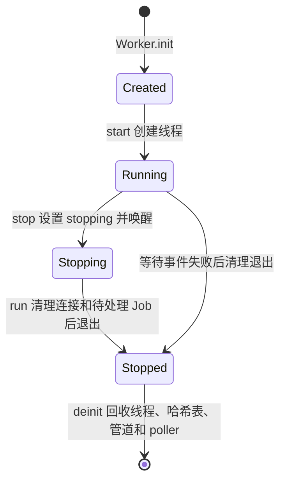

`init`（`src/worker.zig:75`）创建 poller 和 wake pipe，把 wake pipe 的读端以 token 0 注册进 poller，计算预算：

```zig
.buffer_budget = @max(2 * chunk_size, capacity * buffer_budget_per_slot),
```

`start` 创建线程。`stop` 设置标志并唤醒 worker。`deinit` 先请求停止，等待已启动的线程退出，再检查并清理残余 Job，最后释放哈希表、管道和 poller。`main` 先向所有 worker 发停止请求，再逐个等待。队列数组嵌在 `Worker` 里，随 worker 数组回收。

`run` 的清理在 `defer` 里（`src/worker.zig:151`）：设置停止、遍历哈希表销毁所有连接、清空哈希表、丢弃队列里还没处理的 Job。

#### 队列与容量

```zig
// src/worker.zig:116
pub fn submit(self: *Worker, job: Job) bool {
    self.queue_lock.lockUncancelable(self.io);
    if (self.stopping.load(.acquire) or self.job_count == queue_size or
        self.activeCount() >= self.capacity)
    {
        self.queue_lock.unlock(self.io);
        return false;
    }
    const was_empty = self.job_count == 0;
    self.jobs[(self.job_head + self.job_count) % queue_size] = job;
    self.job_count += 1;
    _ = self.active.fetchAdd(1, .monotonic);
    self.queue_lock.unlock(self.io);
    if (was_empty) self.wake_pipe.wake();
    return true;
}
```

三个拒绝条件：worker 正在停、队列满（256）、活跃连接达到配额。

只有队列从空变非空时才唤醒，避免每来一个连接都写一次管道。worker 被唤醒后一次最多处理 64 个 Job（`src/worker.zig:180`）；处理满 64 个时，它无条件再写一次唤醒（`src/worker.zig:185`），下一轮如果队列空了就直接返回，不会空转。为什么要分批？因为一次处理几千个 accept 会让已经在传输的连接得不到事件循环的时间，延迟抖动。

`active` 在入队时就加一，而不是等连接建立。这样容量控制的是"已接单"的连接总数，包括还在队列里、还在拨号的。

#### 事件循环

```zig
// src/worker.zig:162
while (!self.stopping.load(.acquire)) {
    const count = self.poller.wait(&batch) catch |err| {
        std.log.err("worker event wait failed: {s}", .{@errorName(err)});
        return;
    };
    for (batch[0..count]) |event| {
        if (self.stopping.load(.acquire)) return;
        if (event.token == wake_token) {
            self.wake_pipe.drain();
            self.processJobs();
        } else {
            self.processEvent(event, &scratch);
        }
    }
}
```

- token 0 保留给 wake pipe，所以连接 id 从 1 开始，`clientToken(1) = 65536`，不会和 0 冲突。
- `scratch` 是 16 KiB 的栈数组，所有连接共用。这也是为什么写不完的数据必须复制到堆上。
- 每处理一个事件都检查一次 `stopping`，所以 SIGTERM 能在一批事件中间及时生效。

#### 建立连接

`addConnection`（`src/worker.zig:188`）是 Job 变成 Connection 的地方：

```zig
const id = self.next_id;
self.next_id += 1;
var conn: Connection = .{
    .client = .{ .fd = job.client },
    .fallbacks = job.fallbacks,
};
self.openBackend(&conn, job.address) catch |err| {
    std.log.warn("backend dial failed: {s}", .{@errorName(err)});
    self.destroyConnection(&conn);
    return;
};
self.refreshInterests(id, &conn) catch |err| { ... };
self.connections.put(id, conn) catch { ... };
```

顺序很重要：先拨号、再注册事件、最后放进哈希表。任何一步失败都调用 `destroyConnection`，它会关 fd、释放 fallback、减 active。

`openBackend`（`src/worker.zig:211`）会连续尝试地址：

```zig
var address = first;
while (true) {
    const result = sys.connect(address) catch |err| {
        address = nextAddress(conn) orelse return err;  // ← 立即失败就换下一个
        continue;
    };
    conn.backend = .{ .fd = result.fd };
    conn.connecting = !result.connected;   // ← 还在握手？
    if (result.connected) self.freeFallbacks(conn);
    return;
}
```

两种情况：

- `sys.connect` 立即返回错误（比如 `ConnectionRefused`）：换下一个地址，直到用完。
- `sys.connect` 返回 fd 但 `connected=false`：保存 fd，等事件循环通知可写，再由 `finishDial` 确认。

`finishDial`（`src/worker.zig:234`）：

```zig
sys.finishConnect(conn.backend.?.fd) catch |err| {
    sys.close(conn.backend.?.fd);
    conn.backend = null;
    const next = nextAddress(conn) orelse return err;
    return self.openBackend(conn, next);
};
conn.connecting = false;
self.freeFallbacks(conn);
```

异步失败同样会换地址。备用地址耗尽或达到重试上限时，`processEvent` 销毁连接。拨号中的等待依赖内核通知，当前实现没有应用层拨号截止时间（`src/worker.zig:212`）。

一旦连上后端，fallback 列表就不再需要，立刻释放（`freeFallbacks`，`src/worker.zig:245`）。这也是为什么多 IP 后端只在拨号阶段多一次内存分配。

#### 处理事件

`processEvent`（`src/worker.zig:252`）做四件事：

```zig
const id: u48 = @intCast(event.token >> endpoint_token_bits);  // ← 取高 48 位
const conn = self.connections.getPtr(id) orelse return;
const is_client = event.token == clientToken(id);
if (!is_client and event.token != conn.backendToken(id)) return;  // ← 陈旧事件

if (conn.connecting) {
    std.debug.assert(!is_client);
    self.finishDial(conn) catch |err| { ...; self.removeConnection(id, conn); return; };
} else {
    self.forwardReady(conn, is_client, event, scratch) catch |err| { ...; self.removeConnection(id, conn); return; };
    if (conn.to_client.eof and conn.to_backend.eof) { self.removeConnection(id, conn); return; }
}
self.refreshInterests(id, conn) catch |err| { ...; self.removeConnection(id, conn); };
```

关键点：

1. **token 解码**：`id = token >> 16`。端点类型和重试次数在低 16 位（见 6.5）。
2. **陈旧事件过滤**：如果 token 既不是客户端的，也不是当前后端 token，直接忽略。这种情况发生在 fd 被关闭又复用、旧事件还在本批次里的时候。
3. **拨号中**。worker 只监听后端 fd。`finishDial` 返回后，`refreshInterests` 根据 `connecting` 选择继续等新后端 fd，或开始监听两端。
4. **正常结束需要两个方向都读到 EOF**。一个方向先读到 EOF 时，另一个方向仍可转发。
5. **转发错误会销毁整条连接**。读写错误、pending 分配失败或超预算都走这条路径。

#### 转发：`forwardReady` 逐行拆解

这是整个项目的核心函数，只有 28 行，但包含了所有转发语义。

```zig
// src/worker.zig:287
fn forwardReady(self: *Worker, conn: *Connection, is_client: bool, event: events.Event, scratch: []u8) !void {
    const ready_fd = if (is_client) conn.client.fd else conn.backend.?.fd;
    const peer_fd = if (is_client) conn.backend.?.fd else conn.client.fd;
    const outgoing = if (is_client) &conn.to_backend else &conn.to_client;
    const incoming = if (is_client) &conn.to_client else &conn.to_backend;

    if (event.writable) {
        if (incoming.pending) |data| {
            incoming.offset += try writeSome(ready_fd, data[incoming.offset..]);
            if (incoming.offset == data.len) self.freePending(incoming);
        }
    }
    if (!event.readable or !outgoing.canRead()) return;
    const len = (try sys.read(ready_fd, scratch)) orelse return;
    if (len == 0) {
        outgoing.eof = true;
        sys.shutdownWrite(peer_fd);
        return;
    }
    const written = try writeSome(peer_fd, scratch[0..len]);
    if (written == len) return;
    const unsent = scratch[written..len];
    if (unsent.len > self.buffer_budget - self.pending_bytes)
        return error.BufferBudgetExceeded;
    outgoing.pending = try self.allocator.dupe(u8, unsent);
    self.pending_bytes += unsent.len;
}
```

先厘清四个变量的含义：

| 事件来自 | `ready_fd` | `peer_fd` | `outgoing` | `incoming` |
| --- | --- | --- | --- | --- |
| 客户端 | 客户端 fd | 后端 fd | `to_backend` | `to_client` |
| 后端 | 后端 fd | 客户端 fd | `to_client` | `to_backend` |

- `outgoing`：从 ready 端**流出**的数据方向。
- `incoming`：**流向** ready 端的数据方向。

所以"ready 端可写"时要 flush 的是 `incoming.pending`——那是准备写给 ready 端的数据。

**第一段：可写时续传**

```zig
if (event.writable) {
    if (incoming.pending) |data| {
        incoming.offset += try writeSome(ready_fd, data[incoming.offset..]);
        if (incoming.offset == data.len) self.freePending(incoming);
    }
}
```

调用 `writeSome` 从上次的 `offset` 继续写。返回 0 表示 `EAGAIN`，偏移不变，等下次可写。全部写完就释放内存并清零。

**第二段：可读时搬运**

```zig
if (!event.readable or !outgoing.canRead()) return;
```

如果这个方向已经有积压（`pending != null`）或者已经 EOF，就不读。`canRead` 是背压的开关。

```zig
const len = (try sys.read(ready_fd, scratch)) orelse return;
```

`null` 是 `EAGAIN`，说明内核事件和实际状态有瞬间差异，直接返回。

```zig
if (len == 0) {
    outgoing.eof = true;
    sys.shutdownWrite(peer_fd);
    return;
}
```

读到 0 是 FIN。标记方向 EOF，对 peer 半关闭。注意这里没有立即关闭连接，因为反方向可能还有数据。

```zig
const written = try writeSome(peer_fd, scratch[0..len]);
if (written == len) return;
```

尝试一次写出。能全写完就结束，这是最常见的情况。

```zig
const unsent = scratch[written..len];
if (unsent.len > self.buffer_budget - self.pending_bytes)
    return error.BufferBudgetExceeded;
outgoing.pending = try self.allocator.dupe(u8, unsent);
self.pending_bytes += unsent.len;
```

写不完的部分从共享的 `scratch` 复制到堆上，记入总预算。下一次 peer 可写时，第一段会继续写。

注意 `unsent.len` 最大是 16 KiB（一次 read 的上限），所以单个方向的 pending 最多一块 16 KiB。

**分支汇总**

| 事件 | 状态 | 动作 |
| --- | --- | --- |
| 可写 | 该方向有 pending | 续写；写完释放 |
| 可写 | 没有 pending | 什么都不做 |
| 可读 | 该方向 eof 或有 pending | 不读，返回 |
| 可读 | read 返回 null | 返回 |
| 可读 | read 返回 0 | 标记 eof，peer 半关闭 |
| 可读 | 读到了，全部写出 | 返回 |
| 可读 | 读到了，写出一部分 | 剩余复制到 pending |
| 可读 | 复制会超预算 | 返回 `BufferBudgetExceeded`，上层销毁连接 |

`writeSome`（`src/worker.zig:316`）把"写了 0 字节"当成错误：

```zig
fn writeSome(fd: sys.Fd, data: []const u8) !usize {
    const n = (try sys.write(fd, data)) orelse return 0;
    if (n == 0) return error.NoWriteProgress;
    return n;
}
```

`send` 对非空缓冲区返回 0 是反常的（正常要么写一些，要么 `EAGAIN`），所以直接报错，避免死循环。

#### 重新计算兴趣

`refreshInterests`（`src/worker.zig:322`）把连接状态翻译成内核感兴趣的事件：

```zig
if (conn.connecting) {
    try self.setInterest(&conn.backend.?, conn.backendToken(id), .{ .write = true });
    return;
}
try self.setInterest(&conn.client, clientToken(id), .{
    .read = conn.to_backend.canRead(),      // ← 客户端方向未 EOF，且没有积压
    .write = conn.to_client.pending != null, // ← 有数据要写给客户端
});
try self.setInterest(&conn.backend.?, conn.backendToken(id), .{
    .read = conn.to_client.canRead(),
    .write = conn.to_backend.pending != null,
});
```

连接建立后，读写兴趣由两个方向分别决定。表中的四种积压组合假定两个方向都还未读到 EOF。

| 积压 | 客户端兴趣 | 后端兴趣 |
| --- | --- | --- |
| 无 | 读 | 读 |
| 仅 `to_backend.pending` | 无 | 读 + 写 |
| 仅 `to_client.pending` | 读 + 写 | 无 |
| 两个方向都有 pending | 写 | 写 |

某端读到 EOF 后，关掉该端的读兴趣。写兴趣仍由另一方向的 pending 决定，所以已发 FIN 的一端仍可接收数据。拨号中只监听后端写事件。两个方向都 EOF 时销毁连接。

`setInterest`（`src/worker.zig:337`）保存上一次的兴趣，传给 `poller.update` 做差分。

#### 销毁连接

```zig
// src/worker.zig:351
fn destroyConnection(self: *Worker, conn: *Connection) void {
    sys.close(conn.client.fd);
    if (conn.backend) |backend| sys.close(backend.fd);
    self.freePending(&conn.to_backend);
    self.freePending(&conn.to_client);
    self.freeFallbacks(conn);
    _ = self.active.fetchSub(1, .monotonic);
}

fn removeConnection(self: *Worker, id: u48, conn: *Connection) void {
    self.destroyConnection(conn);
    _ = self.connections.remove(id);
}
```

`addConnection` 失败时直接销毁尚未入表的连接。已入表的连接可以在事件处理中销毁并移出哈希表，也可以由 `run` 退出时统一销毁。`destroyConnection` 对每条已出队的连接执行一次。

#### 必须保持的不变量

读或改这个文件之前，先记住这些前提：

1. **连接状态只被一个线程访问**。哈希表、`pending`、兴趣都不加锁。
2. **`pending_bytes` 等于所有连接两个方向 `pending` 长度之和**。超预算检查依赖这个等式。
3. **一个 fd 注册期间 token 不变**。要换 token 必须先删除注册。
4. **token 在所属 worker 的 poller 中标识连接、端点和拨号轮次**。低 16 位不会进位到连接 id。
5. **销毁连接时清理 fd 和内存**。同批后续事件通过 id 重新找连接，已移除的条目直接跳过。
6. **`active` 与连接生命周期同步**：入队加一，销毁减一，中间不重复。
7. **持有 `*Connection` 期间不能向哈希表插入元素**，否则扩容会让指针失效。

### 5.6 `main.zig`：启动、接入和信号

#### 命令行解析

```zig
// src/main.zig:73
const Options = struct {
    listen: []const u8 = ":1248",
    workers: usize,
    config_path: []const u8,
    ...
};
```

支持的写法：

| 写法 | 结果 |
| --- | --- |
| `gopf settings.conf` | 默认监听 `:1248`，worker 数 = min(CPU, 16) |
| `gopf -listen 127.0.0.1:12481 settings.conf` | 指定监听地址 |
| `gopf -listen=127.0.0.1:12481 settings.conf` | 等号形式 |
| `gopf -workers 4 settings.conf` | 4 个 worker |
| `gopf -h` / `gopf --help` | 打印用法，退出码 0 |
| `gopf -- settings.conf` | `--` 之后只当位置参数 |

解析细节（`src/main.zig:78`）：

- 以 `-` 开头且长度大于 1 的当选项；`-h`、`--help` 直接返回 `null`。
- 选项值可以跟空格，也可以用 `=`。
- 未知选项返回 `error.UnknownOption`。
- `-workers 0` 返回 `error.InvalidWorkerCount`。
- 多个位置参数返回 `error.TooManyArguments`。
- 缺少配置路径返回 `error.MissingConfigPath`。

任何解析错误都会打印用法和错误名，退出码 2。

#### 启动顺序与清理

```zig
// src/main.zig:18
pub fn main(init: std.process.Init) !void {
    const options = Options.parse(init.minimal.args) catch |err| { ...exit(2); } orelse { ...return; };

    const allocator = std.heap.smp_allocator;
    var config = Config.load(allocator, init.io, options.config_path) catch |err| { ...exit(1); };
    defer config.deinit();
    const listener = try openListener(allocator, options.listen);
    defer sys.close(listener);
    const port = try sys.boundPort(listener);

    var wake_pipe = try sys.WakePipe.init();
    defer wake_pipe.deinit();
    signal_fd.store(wake_pipe.write_fd, .release);
    defer signal_fd.store(-1, .release);
    installSignalHandlers();

    const workers = try allocator.alloc(Worker, options.workers);
    defer allocator.free(workers);
    var initialized: usize = 0;
    defer {
        for (workers[0..initialized]) |*worker| worker.stop();
        for (workers[0..initialized]) |*worker| worker.deinit();
    }
    ...
}
```

清理顺序与创建顺序相反，这是 `defer` 的后进先出保证的：

```text
创建：config → listener → wake pipe → signals → workers → acceptor
清理：acceptor 返回 → workers（stop 全部，再 deinit）→ 释放 worker 数组 → signal_fd 置 -1 → wake pipe → listener → config
```

`initialized` 计数保证只清理真正初始化成功的 worker。如果第 3 个 worker 的 `init` 失败，前两个会被正确停止和释放。

#### 连接配额怎么分

```zig
// src/main.zig:50
const capacity = (connection_budget - 1) / workers.len + 1;
```

这是向上取整的写法：`ceil(16384 / workers)`。例如：

| workers | capacity | 总配额（workers × capacity） |
| ---: | ---: | ---: |
| 1 | 16384 | 16384 |
| 2 | 8192 | 16384 |
| 4 | 4096 | 16384 |
| 12 | 1366 | 16392 |
| 16 | 1024 | 16384 |

合计配额最多比基准多 `workers - 1` 条。若配额内的连接全部已经拨通，连接 fd 数为 `2 × workers × capacity`，另有监听、管道和 poller 等固定开销。第 6.9 节给出计算。

#### 接入循环

`Acceptor.run`（`src/main.zig:128`）只做一件事：等事件、分派。

```zig
var events = [_]posix.pollfd{
    .{ .fd = self.wake_pipe.read_fd, .events = posix.POLL.IN, .revents = 0 },
    .{ .fd = self.listener, .events = posix.POLL.IN, .revents = 0 },
};
while (true) {
    _ = try posix.poll(&events, -1);
    if (events[0].revents & posix.POLL.IN != 0) {
        self.wake_pipe.drain();
        const signals = pending_signals.swap(0, .acq_rel);
        if (signals & signal_stop != 0) return;
        if (signals & signal_reload != 0) self.reload();
        if (signals & signal_status != 0) self.reportStatus();
    }
    if (events[1].revents & (posix.POLL.ERR | posix.POLL.HUP | posix.POLL.NVAL) != 0) {
        return error.ListenerFailed;
    }
    if (events[1].revents & posix.POLL.IN != 0) {
        self.acceptBatch() catch |err| {
            std.debug.print("accept failed: {s}\n", .{@errorName(err)});
            _ = try posix.poll(events[0..1], 50);  // ← 退避 50ms
        };
    }
}
```

- `poll` 的超时是 -1，永远阻塞，直到有事件。
- 先处理信号，再处理监听 fd。STOP 优先于 RELOAD 和 STATUS（`return` 直接结束）。
- 监听 fd 出错（ERR/HUP/NVAL）说明监听已经不可用，进程没有继续的意义，返回错误。
- accept 失败（比如 fd 用完）时打印日志，然后只等 wake pipe 50 毫秒。为什么要退避？因为监听 fd 会一直可读，立刻重试会空转烧 CPU。

一个细节：`events` 数组的 `revents` 不需要手动清零。每次 `poll` 都会重写它。

#### 批量 accept 与分发

```zig
// src/main.zig:155
fn acceptBatch(self: *Acceptor) !void {
    for (0..accept_batch) |_| {                 // ← 最多 64 条
        const client = try sys.accept(self.listener) orelse return;
        self.total +|= 1;
        std.debug.print("accepted fd {d}\n", .{client});
        if (!self.dispatch(client)) {
            self.dropped +|= 1;
            sys.close(client);
        }
    }
}
```

一次醒来最多接 64 条，然后回到 `poll` 处理信号和其它事件。这防止连接风暴时信号被饿死。

`dispatch`（`src/main.zig:167`）：

```zig
const addresses = self.config.choose(self.prng.random()) orelse return false;
const fallbacks: []const sys.Address = if (addresses.len > 1)
    self.allocator.dupe(sys.Address, addresses[1..]) catch return false
else
    &.{};
for (0..self.workers.len) |_| {
    const worker = &self.workers[self.next_worker];
    self.next_worker = (self.next_worker + 1) % self.workers.len;
    if (worker.submit(.{ .client = client, .address = addresses[0], .fallbacks = fallbacks })) return true;
}
self.allocator.free(fallbacks);
return false;
```

- 没有可用后端（权重全零）→ 返回 false，客户端被关。
- 有多个 IP → 复制 `[1..]` 作为 fallback；只有一个 IP → 用空切片，不分配。
- 轮转选 worker：从 `next_worker` 开始，最多试一圈。任何一个接受就返回。
- 全都被拒绝 → 释放 fallback，返回 false。

`next_worker` 由接入线程维护。每次尝试后移动到下一位，第一个成功入队的 worker 接单。已建立连接的寿命和流量仍可能不同。

#### 信号处理

```zig
// src/main.zig:217
fn installSignalHandlers() void {
    const action: posix.Sigaction = .{
        .handler = .{ .handler = onSignal },
        .mask = posix.sigemptyset(),
        .flags = 0,
    };
    for ([_]posix.SIG{ .HUP, .USR1, .TERM, .INT }) |sig| {
        posix.sigaction(sig, &action, null);
    }
}

fn onSignal(sig: posix.SIG) callconv(.c) void {
    const flag: u32 = switch (sig) {
        .HUP => signal_reload,
        .USR1 => signal_status,
        .TERM, .INT => signal_stop,
        else => unreachable,
    };
    _ = pending_signals.fetchOr(flag, .release);
    const fd = signal_fd.load(.acquire);
    if (fd >= 0) sys.wakePipeFd(fd);
}
```

`pending_signals` 的三个位：

| 位 | 值 | 信号 | 行为 |
| ---: | ---: | --- | --- |
| 0 | 1 | SIGHUP | 重载配置 |
| 1 | 2 | SIGUSR1 | 打印状态 |
| 2 | 4 | SIGTERM / SIGINT | 停止 |

`fd >= 0` 的判断是必要的：进程退出阶段 `signal_fd` 会被置 -1，此时再来的信号不应该写一个已关闭的 fd。

#### 状态输出

```zig
// src/main.zig:194
fn reportStatus(self: *Acceptor) void {
    var active: usize = 0;
    for (self.workers) |*worker| active += worker.activeCount();
    std.debug.print("status: active={d} total={d} dropped={d} workers={d} hosts={d} total_weight={d}\n", .{
        active, self.total, self.dropped, self.workers.len, self.config.hosts.len, self.config.total_weight,
    });
}
```

字段含义：

- `active`：所有 worker 的活跃连接数之和，包括排队和拨号中的。
- `total`：进程启动以来 accept 的总数。
- `dropped` 统计接入线程移交失败后关闭的客户端 fd，包括无可用后端、复制备用地址失败、所有 worker 拒绝。拨号失败由 worker 另行处理。
- `hosts`、`total_weight`：当前配置摘要。

### 5.7 `integration.zig`：worker 的回环 TCP 集成测试

#### 测试夹具的技巧

正常流程是"gopf 监听，客户端连进来"。测试里没有 gopf 的接入线程，怎么办？

`Peers.open`（`src/integration.zig:113`）让测试自己扮演接入线程：

1. 建两个回环监听 socket：`frontend_listener` 和 `backend_listener`，端口都由内核分配（`:0`）。
2. 测试作为客户端，`connect` 到 `frontend_listener`，拿到 `client_conn`。
3. 测试作为"gopf 的 acceptor"，`accept(frontend_listener)` 拿到 `accepted_client`。
4. 把 `accepted_client` 和 `backend_listener` 的地址交给 `worker.submit`。
5. worker 拨号到 `backend_listener`，测试 `accept` 拿到 `backend`。

于是测试里的 `client_conn` 和 `backend` 就是一条穿过 worker 的完整连接。整个过程不经过 `main.zig`，只测 worker 的转发逻辑。

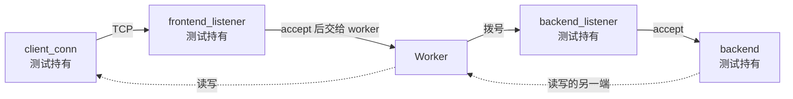

#### 故意制造背压

背压测试（`src/integration.zig:46`）向内核请求 4 KiB 的收发缓冲。设置涵盖测试客户端、代理 accept 得到的客户端 fd，以及测试后端三个 fd。下面是客户端一侧的设置（`src/integration.zig:131`）。

```zig
// src/integration.zig:131
if (limit_buffers) {
    try setBufferSize(client_conn.fd, posix.SO.RCVBUF, restricted_buffer);
    try setBufferSize(client_conn.fd, posix.SO.SNDBUF, restricted_buffer);
    try setBufferSize(accepted_client, posix.SO.SNDBUF, restricted_buffer);
    try setBufferSize(accepted_client, posix.SO.RCVBUF, restricted_buffer);
}
```

小缓冲有助于在回环连接上触发背压。测试分别以客户端和后端作为发送端，执行下面的步骤。

1. 尝试写入 8 MiB 测试数据。遇到 `EAGAIN` 后，等到 250 ms 内仍未变为可写时，记下已写入的字节数 `sent`（`src/integration.zig:191`）。
2. 在反方向发送 `"reverse traffic"`，确认接收字节正确。
3. 将测试接收端的 `SO_RCVBUF` 调整为 256 KiB，再让发送端半关闭写方向。
4. 接收端验证完整的 `payload[0..sent]`，随后读到 EOF。
5. 接收端也半关闭写方向，发送端应读到 EOF。

[bench.md](bench.md) 记录了第一次 Linux 测试在排空阶段超时。当前夹具在核验反向传输后就调大接收缓冲，再检查积压数据能否完整送达。

#### 四个测试分别验证什么

| 测试 | 验证的行为 | 为什么重要 |
| --- | --- | --- |
| `client FIN reaches backend before the backend replies` | 客户端半关闭后，后端仍能收到请求、读到 EOF 并回响应 | 正向 EOF 后仍可收响应 |
| `backend FIN reaches client before the client replies` | 后端半关闭后，客户端仍能继续发数据 | 反向半关闭同样不能丢数据 |
| `backpressure in either TCP direction leaves the opposite direction running` | 一个方向卡住不影响另一个方向 | 防止队头阻塞整个连接 |
| `forward 1 MiB payload byte for byte` | 大块数据逐字节一致 | 验证没有截断、乱序、重复 |

#### 测试辅助函数

- `expectData(fd, expected)`（`src/integration.zig:208`）：循环读到期望长度，每次比较前缀；超时 5 秒。
- `expectEof(fd)`：读 1 字节，必须是 0。
- `writeAll(fd, data)`：循环写直到写完，遇到 `EAGAIN` 就 `poll` 等可写。
- `fillUntilBackpressured(fd, data)` 循环写入。遇到 `EAGAIN` 后，若 250 ms 内仍不可写，返回已写字节数。
- `deadlineAfter(ms)` / `monotonicNow()`：用单调时钟算截止时间，避免系统时间调整影响测试。
- `readyBy(fd, events, deadline)`：带截止时间的 `poll`。

测试端的 I/O 辅助函数调用 `sys.zig`，用 `posix.poll` 等待就绪。它们产生和接收穿过 worker 的测试流量。

---

## 6. 关键机制专题

前面按文件讲了"是什么"，这一章按机制讲"为什么"和"边界在哪里"。

### 6.1 连接状态机

一条代理连接在 gopf 里只会处于下面几个状态之一：

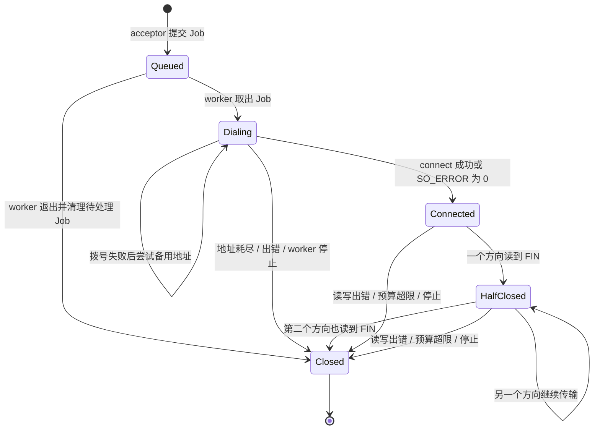

| 状态 | 判断依据 | 允许的事件 | 代码 |
| --- | --- | --- | --- |
| Queued | 在 `jobs` 数组里 | 被 worker 取出或取消 | `src/worker.zig:143`、`src/worker.zig:182` |
| Dialing | `conn.connecting == true` | 后端 fd 报告就绪，查询 `SO_ERROR` | `src/worker.zig:234`、`src/worker.zig:258` |
| Connected | `connecting == false`，两个 `eof` 都 false | 两端读写 | `src/worker.zig:265` |
| HalfClosed | 恰好一个 `eof == true` | 剩余方向继续 | `src/worker.zig:275` |
| Closed | fd 已关、拥有的缓冲已释放，已入表的条目已移除 | 无 | `src/worker.zig:143`、`src/worker.zig:351` |

两个容易忽略的点：

1. **没有单独的 "Closing" 状态**。半关闭不是显式状态，而是靠两个 `Direction.eof` 布尔值组合出来的。这比维护一个枚举简单，也不会出现状态不同步。
2. **失败后只试同一 host 的备用地址**。备用地址耗尽或达到重试上限时，关闭客户端连接。

### 6.2 一次转发的完整时序

以客户端向后端发送数据为例。图中假定一次读取已拿到字节，接着尝试转发。

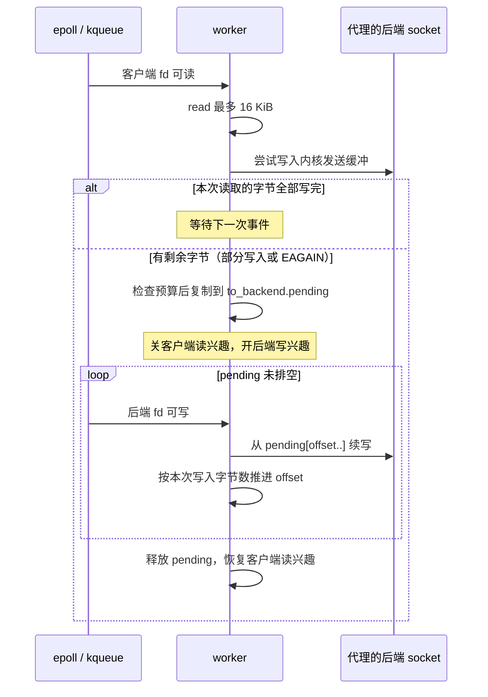

`forwardReady` 也会在后端可读时处理反向数据。一次 `read` 返回的是当前拿到的字节数，可能小于 16 KiB。读到 0 按 EOF 处理，`EAGAIN` 则等下一次就绪。

### 6.3 半关闭：为什么不能一看到 FIN 就 close

假设 gopf 简化成"客户端 EOF 就关闭整条连接"，会发生什么：

```text
客户端：GET / HTTP/1.1 ... 然后 shutdown(WR)
gopf：读到 0，关闭后端 fd
后端：请求还没处理完，连接没了 → 响应发不出去
```

客户端可以在发出请求后用 FIN 表示请求字节已经发完，同时继续接收响应。此时代理需要把 EOF 传递给后端，并继续转发后端的响应。

| 事件 | gopf 的动作 | 不这样做的后果 |
| --- | --- | --- |
| 客户端读返回 0 | `to_backend.eof = true`，对后端 `shutdownWrite` | 后端的 `read` 永远等不到 EOF，可能一直挂着 |
| 后端读返回 0 | `to_client.eof = true`，对客户端 `shutdownWrite` | 客户端不知道响应结束了 |
| 两个方向都 EOF | 关闭两个 fd | 连接泄漏 |
| 只有一方 EOF | 继续服务另一方 | 丢响应或丢请求 |

`canRead` 要求 `pending == null`。worker 可以先经历一段积压，等该方向所有已读字节都交给出站 socket 的内核发送缓冲后，再读取并处理 EOF。随后调用 `shutdownWrite`，TCP 按序发送已提交的数据和 FIN。

反方向的 pending 不受影响。比如客户端已经 EOF，后端还在发响应，`to_client.pending` 照常工作。

### 6.4 背压与缓冲预算

#### 两级背压

以下是客户端向后端转发时，背压从后端逐步传回客户端的过程。反方向使用同样的机制。

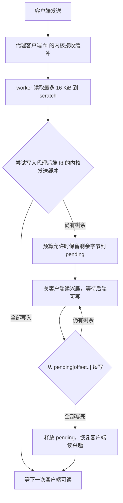

- 后端读取慢时，代理的出站发送缓冲可能装满。一次 `send` 可能只写入部分字节，也可能返回 `EAGAIN`。
- worker 保留当前块的剩余字节，然后暂停这一方向的读取。代理前端的接收缓冲逐步填满，TCP 接收窗口随之收缩，客户端的发送受到限制。

每个方向最多保留一块不超过 16 KiB 的 pending。一个方向停读时，另一方向可以按自己的就绪状态继续转发。

#### 预算怎么算

```zig
// src/worker.zig:88
.buffer_budget = @max(2 * chunk_size, capacity * buffer_budget_per_slot),
```

| 量 | 公式 | 含义 |
| --- | --- | --- |
| 单方向 pending 上限 | 16 KiB | 一次 `read` 最多这么多 |
| 单连接 pending 上限 | 32 KiB | 两个方向各一块 |
| worker 预算 | `max(32 KiB, capacity × 8 KiB)` | 所有连接 pending 之和的上限 |

用 12 个 worker 时，每个 worker 有 1366 个连接槽和约 10.7 MiB 的 pending 预算。如果每个槽都要保留两块 16 KiB，需要约 42.7 MiB，超过单 worker 预算。

触发时（`src/worker.zig:310`）：

```zig
if (unsent.len > self.buffer_budget - self.pending_bytes)
    return error.BufferBudgetExceeded;
```

连接被销毁，日志级别是 `warn`：

```zig
if (err == error.BufferBudgetExceeded) {
    std.log.warn("worker buffer budget exhausted, closing connection", .{});
}
```

超预算时，关闭当前申请 pending 的连接。代码已经从源端读到这些字节，但预算不足以保留余下未写的数据。关闭时也会释放该连接已经持有的 pending。来自两个转发方向的分配计入同一 worker 预算。

`pending_bytes` 按已分配块的长度记账。部分续写只增加 offset，整块释放时才从预算中扣除原长度。

#### 为什么 pending 用 `dupe` 而不是引用 scratch

`scratch` 是每个 worker 一块 16 KiB 的栈数组，所有连接共用。下次 `read` 会覆盖它。所以只要数据要跨事件保留，就必须复制。代价是慢路径多一次内存分配和拷贝；快路径（一次写完）完全没有额外分配。

本实现经用户态 scratch 转发。Go 原版在 Linux 上走 `splice` 时，数据留在内核并使用管道 fd。第 7 章给出实测对比。

### 6.5 token：用 64 位整数找回连接

#### 位布局

```text
 63                          16 15                           0
+------------------------------+------------------------------+
|        连接 id（48 位）      |   端点 + 重试次数（16 位）   |
+------------------------------+------------------------------+
```

```zig
// src/worker.zig:50
fn clientToken(id: u48) u64 {
    return @as(u64, id) << endpoint_token_bits;  // ← 低 16 位为 0
}

fn backendToken(self: *const Connection, id: u48) u64 {
    return clientToken(id) + 1 + self.tried_fallbacks;  // ← 低 16 位 ≥ 1
}
```

| 端点 | 低 16 位 | 例子（id=7） |
| --- | ---: | --- |
| 客户端 | 0 | `0x0007_0000` = 458752 |
| 后端，第一次拨号 | 1 | 458753 |
| 后端，第一次换地址后 | 2 | 458754 |
| 后端，第 n 次换地址后 | n+1 | 458752 + n + 1 |

`nextAddress` 会限制重试次数（`src/worker.zig:228`）：

```zig
if (conn.tried_fallbacks == conn.fallbacks.len or
    conn.tried_fallbacks == std.math.maxInt(u16) - 1) return null;
```

低 16 位最多为 65535，编码不会进位到连接 id。每个 worker 都有自己的 poller，连接 id 各自从 1 开始。token 只需在所属 worker 内区分连接、端点和拨号轮次。

#### 为什么需要重试次数

内核报告拨号失败后，worker 关闭旧 fd，换下一个地址重新 `connect`。操作系统可能把**同一个 fd 号**分配给新 socket。

此时本批事件里可能还留着旧 socket 的事件，token 是 `clientToken + 1`。如果不区分，worker 会把这个事件当成新 socket 的握手完成，去读一个并没有连上的连接。加上 `tried_fallbacks`，新 socket 的 token 变成 `+2`，旧事件在 `processEvent` 里被丢弃：

```zig
if (!is_client and event.token != conn.backendToken(id)) return;
```

#### 为什么不用指针当 token

也可以把 `*Connection` 的地址塞进 `data.u64`。但：
- 哈希表扩容会让地址失效。
- 连接销毁后地址可能被别的对象复用。
- 指针宽度依赖平台。

用"id + 端点 + 轮次"编码，值永远可控，也不依赖内存布局。

### 6.6 队列、唤醒和批量

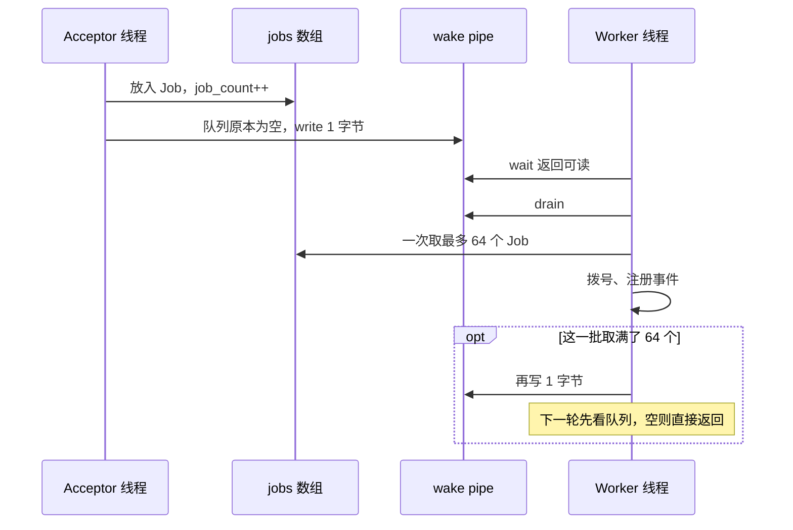

1. **提交时只在队列从空变非空时唤醒**。多个 Job 可以共用一次唤醒。
2. **一次最多处理 64 个 Job**。一批处理完后，worker 可以继续处理已建立连接上的事件。
3. **处理满一批就自我唤醒**。有剩余 Job 时继续处理。队列刚好清空时，再检查一次即返回事件等待。
4. **单个 worker 拒绝后继续轮转**。`submit` 在 worker 已停止、队列满或达到连接配额时返回 false。所有 worker 都拒绝时，接入线程释放备用地址并关闭客户端，`dropped` 加一。

队列是固定数组，用头下标和元素计数做环形索引。`submit` 可能等待队列锁，入队本身没有堆分配。本机 macOS ARM64 上 `@sizeOf(Job)` 为 160 B，256 个槽共 40 KiB。备用地址切片的数据另计。

### 6.7 信号机制的两个细节

**信号会合并**。同一信号在阻塞期间来两次，处理函数可能只被调用一次；不同信号不会合并。gopf 用位掩码，即使同一信号合并了，也只需要处理一次，语义正确。如果逻辑依赖"来了几次"，位掩码就不够，需要计数器。

**处理顺序**。`Acceptor.run` 先检查 `signal_stop`，再 `reload`，再 `reportStatus`：

```zig
if (signals & signal_stop != 0) return;
if (signals & signal_reload != 0) self.reload();
if (signals & signal_status != 0) self.reportStatus();
```

当同一批标志同时包含 TERM 与 HUP 时，停止优先。`Acceptor.run` 当场返回。

**SIGTERM 触发停止和清理**。接入循环处理停止标志后，主线程通知各 worker 停止，worker 清理待处理 Job 和现有连接。如果要加排空阶段，需要在停止接入后保留 worker 运行，等活跃连接归零或达到截止时间再发停止请求（见 9.2）。

### 6.8 配置重载的并发安全

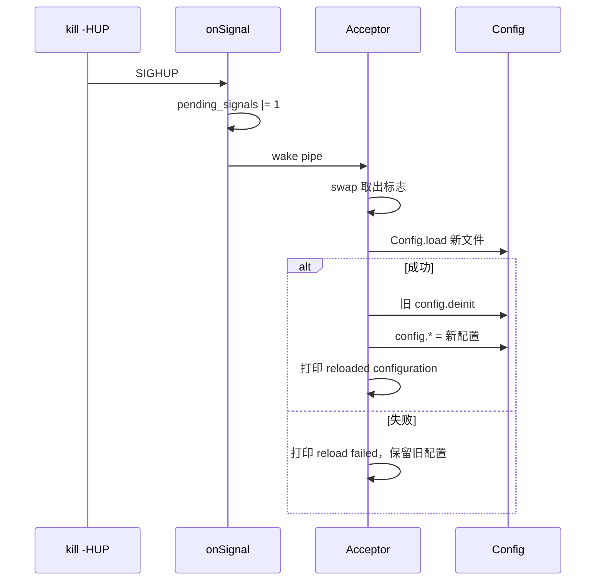

主线程在同一个接入循环里选地址和重载配置。它先把首选地址按值复制到 Job，再为备用地址创建独立切片。`submit` 成功后，这些数据由 worker 侧管理，拨号成功就释放备用地址。旧配置的 arena 可以在重载成功时立即销毁。

两个行为边界：

1. **新选择使用新配置**。已入队的 Job 和正在拨号的连接保留原先的选址结果，已拨通的连接继续使用现有后端 fd。
2. **重载会暂停接入**。`Config.load` 里的 DNS 解析是同步的，解析慢时 accept 会停。极端情况下（DNS 超时几秒），新连接会在内核队列里排队，超过 backlog 后被丢弃。

### 6.9 容量与资源预算

#### 连接数

| 项 | 公式 | 默认值 |
| --- | --- | --- |
| 配额基准 | `connection_budget` | 16384 |
| 单 worker 配额 | `ceil(16384 / workers)` | 随 worker 数变化 |
| 合计配额 | `workers × ceil(16384 / workers)` | 例如 4 个 worker 合计 16384，12 个合计 16392 |
| 单 worker 队列 | `queue_size` | 256 |
| 单次 accept | `accept_batch` | 64 |
| 单次处理 Job | `jobs_per_batch` | 64 |

`active` 在入队时加一。单 worker 配额因此覆盖排队、拨号和转发中的连接。worker 数超过 64 时，单 worker 配额会先于 256 槽的队列达到上限。

#### 文件描述符

```text
fd 总数 ≈ 2 × 已拨通连接数
        + 排队连接数
        + 2 × 正在拨号的连接数（按每条占两个 fd 估算）
        + 2 × workers      （每个 worker 的 wake pipe）
        + 1 × workers      （每个 worker 的 epoll/kqueue fd）
        + 3                （监听 fd + acceptor wake pipe 两个）
        + 3                （stdin/stdout/stderr）
```

排队 Job 只持客户端 fd。拨号阶段最多再持一个后端 fd。以 4 个 worker、16384 条连接都已拨通为例。

```text
2 × 16384 = 32768
2 × 4     = 8
1 × 4     = 4
3 + 3     = 6
合计      = 32786
```

这个场景算出约 32786 个 fd。设置 `ulimit -n` 时还要给配置文件、已 accept 尚未移交的客户端和其他进程内 fd 留余量。

#### 内存

| 项 | 估算 |
| --- | --- |
| 连接表 | 每条连接一个 `Connection` 值，另有 id、哈希表容量及元数据 |
| 队列 | ARM64 本机每 worker 约 40 KiB 的内联 Job 槽，复制出的备用地址另计 |
| pending | 每方向至多 16 KiB，每 worker 再受共享预算约束 |
| 每个 worker 的栈 | 16 KiB scratch、事件数组和调用栈 |
| 进程空闲 RSS | 10000 条空闲连接观测到 macOS 4.5 MiB、Linux 2.30 MiB，见 [bench.md](bench.md) |

4 个 worker 时，pending 数据的预算合计为 128 MiB。这个数只覆盖 pending 已分配的字节，连接表、队列、栈、配置 arena、分配器与内核 socket 缓冲另计。空闲连接通常没有积压，实测 RSS 对应空闲场景。

#### 配额用尽的后果

| 资源 | 用尽时 | 代码 |
| --- | --- | --- |
| 单个 worker 拒绝 | 达到连接配额、队列满或停止时返回 false，接入线程继续尝试 | `src/worker.zig:118`、`src/main.zig:173` |
| 所有 worker 拒绝 | 接入线程释放备用地址，关闭客户端并增加 `dropped` | `src/main.zig:155`、`src/main.zig:178` |
| 进程 fd | accept 失败后记录错误并退避，拨号时则走地址失败处理 | `src/main.zig:146`、`src/worker.zig:211` |
| 内存 | 备用地址复制失败走接入失败，连接表或 pending 分配失败由 worker 销毁当前连接 | `src/main.zig:170`、`src/worker.zig:205`、`src/worker.zig:312` |
| pending 预算 | 关闭当前申请 pending 的连接并记录警告 | `src/worker.zig:266`、`src/worker.zig:310` |

客户端通过 TCP 感知连接关闭。gopf 不构造应用层错误响应。

### 6.10 错误处理哲学

这份代码的错误策略可以总结成三句话：

1. **边界处校验，内部依赖不变量**。配置在加载时校验完；连接层假设 fd 有效、token 有效。
2. **单条连接的错误不影响其它连接**。读写失败只销毁这一条。
3. **基础设施错误才升级到进程级**。监听失败、poller 创建失败、配置初始加载失败会退出。

| 错误来源 | 检测点 | 处理 | 日志级别 |
| --- | --- | --- | --- |
| 配置语法/校验 | `Config.parse` | 启动失败或重载回滚 | `std.debug.print` |
| 域名解析 | `sys.resolve` | 同上 | 同上 |
| accept 失败 | `acceptBatch` | 退避 50ms 继续 | `std.debug.print` |
| 监听 fd 出错 | `Acceptor.run` | 进程退出 | 由 main 返回错误 |
| 没有可用后端 | `dispatch` | 关客户端，`dropped++` | `accepted fd` 之后无专门日志 |
| 拨号失败 | `openBackend` | 换地址；全失败则关客户端 | `std.log.warn` |
| 读写出错 | `forwardReady` | 销毁连接 | `std.log.debug` |
| 预算超限 | `forwardReady` | 销毁连接 | `std.log.warn` |
| 注册事件失败 | `refreshInterests` | 销毁连接 | `std.log.err` |
| 哈希表分配失败 | `addConnection` | 销毁连接 | `std.log.err` |
| 事件等待失败 | `Worker.run` | 该 worker 线程退出 | `std.log.err` |

最后一条值得注意：worker 线程退出后，进程还在跑，但已经没有线程处理这个 worker 的连接（`run` 的 defer 会销毁它们）。`main` 不会感知，也不会补一个 worker。这是 9.1 列出的一个健壮性缺口。

ReleaseFast 默认日志级别是 info。`forwardReady` 发生非预算错误时的 `connection I/O ended` 日志使用 debug。两个方向正常读到 EOF 时，代码直接销毁连接，无对应的结束日志。

### 6.11 所有关闭路径

| 触发 | 清理位置 | 清理动作 |
| --- | --- | --- |
| 两个方向都 EOF | `processEvent` → `removeConnection` | 已分别调用 `shutdownWrite`。关闭两个 fd，移除连接 |
| 收发错误、pending 分配失败或预算超限 | `processEvent` → `removeConnection` | 立即销毁该连接 |
| 拨号失败且无后续地址 | `addConnection` 或 `processEvent` | 关闭客户端 fd，释放备选地址 |
| 注册事件或插入连接表失败 | `addConnection` 或 `processEvent` | 关闭当前两端持有的 fd，清理该连接 |
| worker 停止或等待事件失败 | `run` 的 `defer` | 销毁表中所有连接。清理待处理 Job 的客户端 fd 和备选地址 |
| 接入失败 | `dispatch`、`acceptBatch` | 释放已复制的备用地址，关闭客户端 fd |
| 进程收到 SIGTERM 或 SIGINT | `main` 的 `defer` | 停止所有 worker，等待退出，再回收 worker 资源 |

`destroyConnection` 统一关掉仍持有的 fd，释放剩余 pending 和备选地址，然后给 `active` 减一。`discardJobs` 为每个清理的 Job 给 `active` 减一。

---

## 7. 性能：和 Go 原版比，差在哪

> 本章的数字全部来自同目录的 [bench.md](bench.md)。它们是在特定机器上的一次观测，不是通用结论。
> 换机器、换内核、换编译选项，数字都会变。

### 7.1 两种实现的结构差异

| 维度 | Go 原版（308 行） | 这个 Zig 版本 |
| --- | --- | --- |
| 并发单位 | 每条正在转发的连接有 3 个 goroutine（`handleConn` 和两个复制方向） | 每条连接一个状态机，跑在 worker 线程里 |
| 线程 | Go runtime 调度 | 1 个 acceptor + N 个 worker，固定 |
| 事件通知 | Go netpoller（内部 epoll/kqueue） | 直接调 epoll/kqueue |
| 数据路径 | `io.Copy`，Linux 上可能走 `splice`，数据不进用户态 | 始终经过 16 KiB 用户态缓冲 |
| 转发用 fd | TCP socket，走 `splice` 时还用管道 | TCP socket |
| 内存模型 | goroutine 各有栈，`io.Copy` 走通用复制时另用用户态缓冲 | 每 worker 一块共享缓冲，按需分配 pending |
| 半关闭 | 客户端至后端结束时关后端写侧，反方向结束时关客户端读侧 | 任一方向读到 EOF 后，关闭对端写侧 |
| 拨号超时 | 5 秒 | 未实现统一截止时间（TODO） |

Linux 上，`splice` 可以让数据经内核管道从一个 socket 送到另一个 socket。每个方向会用一对管道 fd。原版的 `handleConn` 等待两个复制方向结束后关闭连接。 [Go 原版 `a80116d`](https://github.com/RaindyRoye/gopf/blob/a80116d68efedfe93ed18a99de3f6e23c2564064/main.go#L126-L197)

### 7.2 bench.md 的数据

#### macOS 本机，短连接

Zig 0.17.1 用 `ReleaseFast` 构建，使用 4 个 kqueue worker。Go 用 1.27.4 构建。先以 50 并发预热 2,000 次，再以 100 并发发出 10,000 次请求。各指标取三轮中位数。

| 实现 | 三轮 rps | 中位 rps | p50 | p99 |
| --- | ---: | ---: | ---: | ---: |
| Zig | 13,588 / 12,356 / 12,195 | 12,356 | 7.50 ms | 13.05 ms |
| Go | 13,607 / 12,207 / 13,604 | 13,604 | 7.25 ms | 15.97 ms |

这组短连接测试里，两者吞吐在同一量级，Go 的中位 rps 更高，Zig 的 p99 较低。记录没有单独测量接入、拨号与转发各自的成本。

#### macOS 本机，1 MiB 响应

`/big`，4 并发，100 请求，按响应体折算吞吐。

| 实现 | 吞吐 | p99 |
| --- | ---: | ---: |
| Zig | 1,414 MiB/s | 5.08 ms |
| Go | 648 MiB/s | 81.45 ms |

两个版本各跑一轮。该轮 Zig 的吞吐更高、p99 更低。macOS 测试没有进一步排查延迟差异。

#### Linux（2 逻辑 CPU，内核 3.10，musl 目标）

| 实现 | 短连接中位 rps | p50 | p99 | 1 MiB 中位吞吐 |
| --- | ---: | ---: | ---: | ---: |
| Zig，1 worker | 12,291 | 7.92 ms | 14.24 ms | 454 MiB/s |
| Zig，2 workers | 13,087 | 7.16 ms | 16.30 ms | 428 MiB/s |
| Go 原版 | 10,892 | 8.56 ms | 17.31 ms | 417 MiB/s |

在这台 2 逻辑 CPU 的机器上，Zig 用 2 个 worker 时的短连接中位吞吐比 Go 高约 20%，用 1 个 worker 时的短连接 p99 更低。4 并发的 1 MiB 测试中，三者的中位吞吐为 417–454 MiB/s。

#### 10,000 条在线连接

| 指标 | macOS，4 worker | Linux，2 worker |
| --- | ---: | ---: |
| 建连耗时 | 1.43 s | 0.74 s |
| 拒绝数 | 0 | 0 |
| 双向字节校验 | 10,000/10,000 | 10,000/10,000 |
| 空闲时 OS 线程 | 5 | 3 |
| 进程 RSS | 4.5 MiB | 2.30 MiB |

空闲 RSS 是代理进程的观测值，内核 socket 缓冲另计。Linux 测试给代理进程设置的 fd 软上限为 32,768。

#### 10,000 条连接同时传输

这组测试在 Linux `gz` 上运行，Zig 使用 2 个 worker。客户端先建立 10,000 条连接，再同时发请求。两种代理共用复用响应体的临时后端，请求截止时间均为 180 秒。吞吐按完整响应数和整轮耗时计算，p99 只统计完整响应。

| 负载 | 实现 | 三轮完整响应数 | 中位吞吐 | 中位 p99 |
| --- | --- | --- | ---: | ---: |
| 396 B | Zig | 10,000 / 10,000 / 10,000 | 16,154 rps | 578 ms |
| 396 B | Go | 10,000 / 10,000 / 10,000 | 15,653 rps | 570 ms |
| 1 MiB | Zig | 10,000 / 9,991 / 10,000 | 714 rps，714.30 MiB/s | 13.90 s |
| 1 MiB | Go | 9,894 / 9,905 / 10,000 | 55 rps，55.00 MiB/s | 13.06 s |

Zig 大包第二轮有 9 个响应提前 EOF。两轮诊断复测全部完成，原因未确定。Go 大包前两轮都等到 180 秒截止，第三轮 12.50 秒传完，吞吐 799.84 MiB/s。

这组 Linux 测试在预建连接后记录到 Zig 代理有 20,012 个 fd，Go 有 60,008 个 fd。运行期间 Go 的 40,000 个管道 fd 与双向 `splice` 的管道分配一致。 [Linux 传输记录](bench.md#10000-条连接同时传输)

### 7.3 怎么解读这些数字

1. **短连接看吞吐和尾延迟。** 两台机器的中位吞吐排序不同。同一台 Linux 机器上，从 1 个 worker 增至 2 个，短连接吞吐提高，p99 也升高。
2. **并发大包把完成率和吞吐一起看。** Go 前两轮等待请求截止拖低整轮吞吐。成功样本 p99 只描述完成的请求，因此仍是 13 秒量级。
3. **大量空闲连接看资源占用。** Zig 在两台机器上都保持了 10,000 条在线连接，并验证了双向字节。Linux 的 fd 对照反映两种数据路径的资源差异。记录只提供了 Zig 的空闲 RSS。
4. **Linux 卡顿有线索，根因待定。** 另一次 Linux 10,000 并发排查将客户端截止时间设为 45 秒，并在卡顿时采到了 `splicePump` 和 `spliceDrain`。屏蔽 `WriterTo`/`ReaderFrom` 的 4 轮全通过，仅把反向 `CloseRead` 改成 `CloseWrite` 的 2 轮也全通过，原版同样有多轮通过。 [Linux 卡顿排查](bench.md#go-大包卡顿排查)

### 7.4 性能瓶颈在哪里

下面这些开销可以从代码中定位。现有压测没有分离各项成本。

1. **接入和日志。** 一个 acceptor 串行处理所有 accept，每条连接同步输出 `accepted fd`。可以固定其他条件，单独比较关闭这条日志前后的短连接吞吐。见 `src/main.zig:155`。
2. **连接状态。** worker 按 token 里的 id 查 `AutoHashMap`，新连接要插入表。一个后端解析出多个地址时，acceptor 还会复制备用地址。见 `src/worker.zig:205`、`src/worker.zig:254`、`src/main.zig:169`。
3. **转发。** 每次最多读 16 KiB。转发 1 MiB 时，如果每次都读满并一次写完，需要 64 次读和 64 次写。短读、短写或 `EAGAIN` 会增加调用次数。见 `src/worker.zig:293`。
4. **同步解析。** 启动时解析配置里的后端地址。重载也做同样的解析，此时 acceptor 会暂停接入。见 `src/config.zig:58`、`src/main.zig:182`。

### 7.5 自己复现性能测试

仓库根目录的 `bench_backend.go` 和 `bench_load.go` 可复跑短连接与 4 并发的 1 MiB 响应，步骤见 8.9。在线容量与 10,000 条连接同时传输使用了另写的夹具。 [10,000 并发测试条件](bench.md#10000-条连接同时传输)

---

## 8. 构建、运行、测试与调试

### 8.1 构建

从仓库根目录进入 `codex/`。后续 Zig 构建、运行和测试命令都在该目录执行。

```sh
cd codex

# 调试版，带安全检查，适合开发
zig build

# 发布版，性能测试用
zig build -Doptimize=ReleaseFast

# 跑测试
zig build test
```

产物是 `zig-out/bin/gopf`。`zig build` 默认用 `Debug`，保留运行时安全检查。`ReleaseFast` 是本章性能测试使用的构建模式。

按 Linux 复测的目标交叉编译，最低内核版本指定为 3.10：

```sh
zig build -Doptimize=ReleaseFast -Dtarget=x86_64-linux.3.10-musl --prefix zig-out-linux
```

Linux 产物在 `zig-out-linux/bin/gopf`，本机产物仍在 `zig-out/bin/gopf`。

受限环境下，如果默认缓存不可写，为构建和测试分别指定可写的缓存目录：

```sh
ZIG_LOCAL_CACHE_DIR=/tmp/gopf-cache ZIG_GLOBAL_CACHE_DIR=/tmp/gopf-global-cache zig build
ZIG_LOCAL_CACHE_DIR=/tmp/gopf-cache ZIG_GLOBAL_CACHE_DIR=/tmp/gopf-global-cache zig build test
```

### 8.2 运行

在 `codex/` 中按需选一条命令。代理会在前台运行。

```sh
./zig-out/bin/gopf settings.conf
./zig-out/bin/gopf -listen 127.0.0.1:12481 -workers 4 settings.conf
./zig-out/bin/gopf -listen=127.0.0.1:12481 settings.conf
```

| 参数 | 默认值 | 说明 |
| --- | --- | --- |
| `-listen` | `:1248` | 监听地址；`host:port` 或 `[ipv6]:port`；`host` 为空表示通配 |
| `-workers` | `min(CPU 数, 16)` | 事件循环线程数 |
| 第一个位置参数 | 无 | 配置文件路径，必填 |
| `-h` / `--help` | | 打印用法，退出码 0 |

启动成功后打印：

```text
listening on port 12481 with 4 workers
```

端口是实际绑定成功的端口。监听 `:0` 时，这里会显示内核分配的端口。

### 8.3 配置格式与规则

最小配置：

```json
{"hosts":[{"addr":"127.0.0.1:18091","weight":100}]}
```

多后端、权重不同：

```json
{
  "hosts": [
    { "addr": "127.0.0.1:9001", "weight": 1 },
    { "addr": "127.0.0.1:9002", "weight": 2 },
    { "addr": "localhost:9003", "weight": 3 }
  ]
}
```

IPv6 后端：

```json
{"hosts":[{"addr":"[::1]:9001","weight":1}]}
```

临时禁用某个后端（保留配置、不参与选择、不解析 DNS）：

```json
{"hosts":[{"addr":"127.0.0.1:9009","weight":0}]}
```

规则汇总：

| 规则 | 说明 |
| --- | --- |
| 根必须是对象 | 数组或字符串会报 `InvalidConfig` |
| `hosts` 省略或为 `null` | 等价于空列表，所有新连接被关闭 |
| `hosts` 为其他值时必须是数组 | 其他类型报 `InvalidHosts` |
| 每个元素必须是对象 | 否则 `InvalidHost` |
| `addr` 必须是字符串 | 否则 `InvalidHost` |
| `addr` 必须能拆成 host:port | 否则 `InvalidAddress` |
| 后端端口必须是 1–65535 | 0 只允许用于监听 |
| `weight` 必须是整数 | 浮点、字符串都报 `InvalidWeight` |
| `weight` 缺失或 `null` | 当作 0 |
| `weight` 不得为负 | 否则 `InvalidWeight` |
| 权重和不得超过 `i64` | 否则 `WeightOverflow` |
| 键名大小写不敏感 | `HOSTS`、`Addr` 都认 |
| 重复键 | JSON 先按同一拼写保留最后一个值，再由 `field` 按对象的键顺序取最后一个不区分大小写的匹配项。比如 `"weight":1,"WEIGHT":2,"weight":3` 得到 2 |
| 文件大小上限 | 16 MiB |

### 8.4 真实日志长什么样

下面是在 macOS 上实际跑出来的输出（`-workers 2`，后端用 Python 的 `http.server`）：

```text
listening on port 12481 with 2 workers
accepted fd 12
status: active=0 total=1 dropped=0 workers=2 hosts=1 total_weight=100
reloaded configuration: hosts=1 total_weight=100
accepted fd 12
```

逐行解释：

| 日志 | 含义 |
| --- | --- |
| `listening on port 12481 with 2 workers` | 启动成功，实际监听 12481，2 个 worker |
| `accepted fd 12` | accept 了一条连接，客户端 fd 是 12 |
| `status: active=0 total=1 dropped=0 ...` | SIGUSR1 触发；此刻连接已经结束，所以 active 是 0 |
| `reloaded configuration: hosts=1 total_weight=100` | SIGHUP 重载成功 |
| `accepted fd 12` | fd 号被复用了，这是新连接 |

没有可用后端时：

```text
listening on port 12482 with 12 workers
accepted fd 42
status: active=0 total=1 dropped=1 workers=12 hosts=0 total_weight=0
```

`dropped=1` 说明这条连接因为没有可用后端被关闭，客户端看到的是"连接被对端关闭"。

后端连不上时：

```text
listening on port 12483 with 12 workers
accepted fd 42
warning: backend dial failed: ConnectionRefused
status: active=0 total=1 dropped=0 workers=12 hosts=1 total_weight=1
```

注意 `dropped` 仍是 0：拨号失败不算"丢弃"，它发生在 worker 里，只打 `warning`。

重载失败时：

```text
listening on port 12486 with 12 workers
accepted fd 42
reload failed: InvalidAddress
accepted fd 42
```

旧配置继续生效，代理照常转发。

### 8.5 信号操作手册

从 `codex/` 启动一份代理，并在同一个终端保存它的 PID。后面的命令都针对这一个子进程。

```sh
./zig-out/bin/gopf -listen 127.0.0.1:12481 -workers 2 settings.conf &
gopf_pid=$!
```

等代理输出 `listening` 后，发送信号：

```sh
kill -USR1 "$gopf_pid"
kill -HUP "$gopf_pid"
```

看到 `reloaded configuration` 后，再用 `kill -USR1 "$gopf_pid"` 查看新配置的后端数和权重和。

| 信号 | 效果 |
| --- | --- |
| `SIGUSR1` | 打印 `active/total/dropped/workers/hosts/total_weight` |
| `SIGHUP` | 重新读配置、解析后端地址。失败时打印 `reload failed: <错误>` 并保留旧配置 |
| `SIGTERM` / `SIGINT` | 停止接入并关闭所有连接，正常退出码为 0 |

也可以在该进程运行期间检查数字 fd 的数量和监听端口：

```sh
lsof -p "$gopf_pid" -F f | awk '/^f[0-9]+$/ { n++ } END { print n+0 }'
lsof -nP -a -p "$gopf_pid" -iTCP -sTCP:LISTEN
```

用完这份代理后，在启动它的终端停止并等待子进程：

```sh
kill -TERM "$gopf_pid"
wait "$gopf_pid"
```

| 情况 | 退出码 |
| --- | ---: |
| 正常退出、`-h`、SIGTERM/SIGINT | 0 |
| 配置文件读不到、解析失败、监听失败 | 1 |
| 命令行参数错误 | 2 |

缺少配置路径会打印用法和 `MissingConfigPath`，退出码为 2。

### 8.6 测试

```sh
zig build test
```

下面是 macOS ARM64 上直接运行 `zig test src/tests.zig -lc` 的输出：

```text
1/8 tests.test_0...OK
2/8 config.test.configuration accepts case-insensitive keys and excludes zero weight from selection...OK
3/8 config.test.empty and zero-weight configurations return no backend...OK
4/8 config.test.configuration rejects invalid hosts, negative weights, and overflow...OK
5/8 integration.test.client FIN reaches backend before the backend replies...OK
6/8 integration.test.backend FIN reaches client before the client replies...OK
7/8 integration.test.backpressure in either TCP direction leaves the opposite direction running...OK
8/8 integration.test.forward 1 MiB payload byte for byte...OK
All 8 tests passed.
```

只跑配置测试：

```sh
zig test src/config.zig -lc
```

只跑某个集成测试：

```sh
zig test src/integration.zig -lc --test-filter "backpressure"
```

集成测试会绑定回环端口、创建真实线程，在容器里跑需要允许 `bind`/`connect` 到 `127.0.0.1`。

### 8.7 手工验证：十分钟走一遍

终端 A 启动 Python 自带的 HTTP 后端，并保持运行：

```sh
gopf_www_dir=$(mktemp -d /tmp/gopf-www.XXXXXX)
echo 'hello through gopf' > "$gopf_www_dir/index.html"
(cd "$gopf_www_dir" && python3 -m http.server 18091 --bind 127.0.0.1)
```

终端 B 在 `codex/` 下准备配置、启动代理并保存本次的 PID。若还有代理在监听 12481，先在它的启动终端结束它。

```sh
gopf_config=$(mktemp /tmp/gopf-conf.XXXXXX)
printf '{"hosts":[{"addr":"127.0.0.1:18091","weight":100}]}\n' > "$gopf_config"
./zig-out/bin/gopf -listen 127.0.0.1:12481 -workers 2 "$gopf_config" &
gopf_pid=$!
```

终端 B 输出 `listening` 后，在终端 C 验证：

```sh
curl --noproxy '*' http://127.0.0.1:12481/index.html
# hello through gopf

# 用 nc 手写一个 HTTP 请求，观察响应
printf 'GET /index.html HTTP/1.0\r\n\r\n' | nc 127.0.0.1 12481
```

`--noproxy '*'` 让 curl 直接连接本机代理。要观察空闲连接，在终端 C 运行 `nc 127.0.0.1 12481`，保持连接打开，再在终端 B 运行 `kill -USR1 "$gopf_pid"`。只有这一条连接时，状态中的 `active` 为 1。

结束时，在终端 C 退出 `nc`，在终端 B 执行 `kill -TERM "$gopf_pid"` 和 `wait "$gopf_pid"`，最后在终端 A 按 Ctrl-C。

### 8.8 故障排查

| 症状 | 可能原因 | 排查方法 |
| --- | --- | --- |
| 启动即退出，`configuration ...: FileNotFound` | 配置路径不对 | `ls` 确认路径；相对路径是当前工作目录 |
| `configuration ...: InvalidAddress` | `addr` 少了端口，或端口非法 | 用 `127.0.0.1:9001` 这种完整写法 |
| `configuration ...: InvalidWeight` | 权重是浮点或字符串，或为负 | 改成整数 |
| `AddressInUse` | 端口被别的进程占用 | `lsof -nP -iTCP:12481 -sTCP:LISTEN` |
| `AddressNotAvailable` | 绑定了本机不存在的 IP | `ifconfig` / `ip addr` 看本机地址 |
| curl 提示空响应或读取失败 | 接入拒绝、拨号失败或对端中断 | 看 gopf 的拨号和状态日志 |
| `warning: backend dial failed: ConnectionRefused` | 后端没起来，或端口不对 | 直接连后端验证 |
| 大量 `accepted fd` 但客户端拿不到响应 | 后端很慢，pending 积压 | 看后端日志；必要时抓包 |
| `ProcessFdQuotaExceeded` | `ulimit -n` 太小 | 按 6.9 的公式提高上限 |
| accept 一直失败 | 系统 fd 或内存耗尽 | `dmesg`、`lsof`、看 `SystemResources` |
| `reload failed` 但服务正常 | 新配置非法 | 修正后重新发 SIGHUP；旧配置仍在生效 |
| 状态里 `active` 不降 | 仍有排队、拨号中或已建立的连接 | 用 `lsof` 看 fd，并检查客户端和后端何时关闭连接 |
| 重载后请求仍走旧后端 | 客户端可能复用了旧连接，或重载失败 | 确认重载成功，再新建 TCP 连接验证 |

### 8.9 压测

分三个终端运行。先完成 8.7 的清理，释放 18091 和 12481。仓库自带的后端对普通路径返回 396 字节，对 `/big` 返回 1 MiB。

终端 A 在仓库根目录构建两个 Go 工具，再保持后端运行：

```sh
go build -o bench_backend bench_backend.go
go build -o bench_load bench_load.go
./bench_backend -addr 127.0.0.1:18091
```

终端 B 在 `codex/` 目录构建和运行代理：

```sh
zig build -Doptimize=ReleaseFast
gopf_bench_config=$(mktemp /tmp/gopf-bench.XXXXXX)
printf '{"hosts":[{"addr":"127.0.0.1:18091","weight":100}]}\n' > "$gopf_bench_config"
./zig-out/bin/gopf -listen 127.0.0.1:12481 -workers 4 "$gopf_bench_config"
```

等终端 B 输出 `listening`，终端 C 在仓库根目录发压：

```sh
# 预热
./bench_load -addr 127.0.0.1:12481 -conns 50 -reqs 2000
# 正式跑三轮
./bench_load -addr 127.0.0.1:12481 -conns 100 -reqs 10000
./bench_load -addr 127.0.0.1:12481 -conns 100 -reqs 10000
./bench_load -addr 127.0.0.1:12481 -conns 100 -reqs 10000
# 大包
./bench_load -addr 127.0.0.1:12481 -path /big -conns 4 -reqs 100
```

对照 Go 时，在终端 B 停止 Zig 代理，再用 `-listen 127.0.0.1:12481` 和同一份配置运行编译好的 Go 原版 `a80116d`。用终端 C 重跑同一批命令。所有压测结束后，在终端 B 和 A 分别按 Ctrl-C。

这套脚本测逐请求建连的吞吐和延迟。`reqs=` 统计拨号成功且结束读取的样本，读错误也会结束读取。第 7.2 节的 10,000 条预建连接测试用单独的客户端校验响应是否完整，并使用复用响应体的临时后端。记录对照时的机器、构建选项与 worker 数，便于区分环境差异。 [压测器计数](../bench_load.go#L36-L51) [预建连接测试条件](bench.md#10000-条连接同时传输)

---

## 9. 已知限制、TODO 和扩展指南

这一章是给"要改它的人"准备的。先看清边界，再动手。

### 9.1 已知限制

| # | 限制 | 现状 | 影响 | 代码位置 |
| ---: | --- | --- | --- | --- |
| 1 | 拨号没有统一的 5 秒截止时间 | 即时失败或异步完成失败时可尝试备用地址，未设拨号计时器 | 不响应 SYN 的后端会占用配额，直到内核报告失败或代理停机 | `src/worker.zig:211` |
| 2 | DNS 在 acceptor 线程同步解析 | 启动和重载时解析 | 解析慢会暂停 accept，新连接可能被内核丢弃 | `src/config.zig:61` |
| 3 | 只有一个 acceptor 线程 | 所有 accept 串行 | 提高 worker 数不会增加接入线程数 | `src/main.zig:128` |
| 4 | 只打开一个监听 socket | `openListener` 返回解析结果中最先监听成功的 socket | `:1248` 覆盖的地址族由选中的地址和系统的双栈设置决定 | `src/main.zig:203` |
| 5 | 没有健康检查 | 后端挂了仍会被选中 | 部分连接失败，直到人工改配置 | `src/config.zig:71` |
| 6 | 缺少请求级日志和指标接口 | 可以按信号查看总计数，运行和错误日志写 stderr | 无法从应用日志追踪某个请求 | `src/main.zig:194` |
| 7 | 每次 accept 同步写 stderr | `std.debug.print` | 高并发时串行化接入线程 | `src/main.zig:159` |
| 8 | 没有优雅停机 | SIGTERM 直接关闭所有连接 | 正在传输的请求会中断 | `src/worker.zig:97` |
| 9 | worker 线程死亡无人监管 | `run` 出错就退出 | 进程还在，但少了一个 worker；连接已被清理 | `src/worker.zig:163` |
| 10 | 连接不迁移 | 按轮转固定分配 | 某个 worker 上的长连接会让负载偏斜 | `src/main.zig:173` |
| 11 | 没有空闲超时 | 只有 TCP keepalive | 双方都活着但都不发数据的连接会一直占配额 | `src/sys.zig:248` |
| 12 | 纯 TCP 字节转发 | 透传 TLS 字节，后端看到的是代理的源地址 | TLS 终止、原客户端地址传递和 UDP 都需要额外实现 | 架构层面 |
| 13 | 只支持 Linux 和 macOS | 其它平台 `@compileError` | Windows、FreeBSD 不能编译 | `src/poller.zig:27` |
| 14 | 重载不能改监听地址和 worker 数 | 只替换配置 | 改这两项必须重启 | `src/main.zig:182` |
| 15 | 连接 id 是 `u48` | 递增分配，代码未处理溢出 | 单个 worker 累计分配约 2.8 × 10^14 个连接 id 后碰到上限 | `src/worker.zig:190` |
| 16 | 预算超限直接关连接 | 不做排队或降级 | 极端背压下会牺牲最晚触发的那条连接 | `src/worker.zig:310` |
| 17 | 日志没有时间戳，级别也只由编译模式决定 | accept 等日志用 `std.debug.print`；`std.log` 在 ReleaseFast 下只输出 info 及以上 | 排查时序问题困难，debug 日志在发布版看不到 | 全局 |

Go 原版的拨号超时是 5 秒。这份 Zig 实现在立即失败时可以很快尝试备用地址。在途拨号等待内核报告结果，期间继续占用 worker 配额。

处理 `:1248` 时，`getaddrinfo` 的主机参数是 NULL，并设置 `AI_PASSIVE`。如果监听 IPv4 通配地址，只覆盖 IPv4。如果监听 IPv6 通配地址，`IPV6_V6ONLY` 决定能否同时接收 IPv4 映射地址。需要显式分开管理两种监听地址时，可以各开一个 socket。

### 9.2 扩展指南

| 想做的事 | 动哪里 | 做法 | 注意 |
| --- | --- | --- | --- |
| 加拨号超时 | `worker.zig`、`poller.zig` | worker 为一次拨号及其备用地址维护同一截止时间，按最近截止时间设置 `Poller.wait` 的等待时长 | 到期关闭连接。Linux 把时长传给 `epoll_wait`，macOS 把时长传给 `kevent64`。只有事件报告拨号就绪后才检查 `SO_ERROR` |
| 多 acceptor | `main.zig` | 用 `SO_REUSEPORT` 让每个 worker 自己 `listen`，不再经过队列 | 连接由内核分配，轮转逻辑消失；统计要改成汇总各 worker |
| 分开监听 IPv4 和 IPv6 | `main.zig`、`sys.zig` | 分别监听 `0.0.0.0:port` 和 `[::]:port`，接入线程 `poll` 两个 listener | IPv6 socket 应明确设置 `IPV6_V6ONLY`，接入线程也要分别处理两个 listener 的就绪事件 |
| 加指标 | `worker.zig`、`main.zig` | 在 `addConnection`、`destroyConnection`、`forwardReady` 累加原子计数；SIGUSR1 或独立线程定期输出 | 不要在高频路径上做格式化 |
| 加访问日志 | `worker.zig` | 在 `addConnection` 记录开始时间和后端地址；`destroyConnection` 输出字节数和时长 | `Connection` 要加字段；日志要异步或抽样 |
| 加健康检查 | 新文件 + `main.zig` | 后台线程定期拨后端，失败时把权重临时设为 0；配置重载时合并 | 不要把检查结果写回配置文件；要有恢复机制 |
| 支持 PROXY protocol | `sys.zig`、`worker.zig` | 向后端发送时，用 TCP 对端地址生成头，先发头再转发。接收模式只对明确配置的受信上游解析 PROXY 头 | 当前 `accept` 丢弃了对端地址。解析要处理半包，并限制头部大小 |
| 优雅停机 | `worker.zig`、`main.zig` | 接入线程先停止接收连接，worker 继续处理队列和存量连接。等 `active` 归零或到截止时间，再调用 `Worker.stop` 和 `deinit` | 区分停止接入和停止事件循环两个阶段 |
| 换哈希表为 slab | `worker.zig` | `Connection` 放进固定数组，空闲链表回收槽位 | token 需要区分同一槽位的不同连接，避免旧事件被派给新连接 |
| 加配置项 | `config.zig` | 加 `dial_timeout_ms`、`idle_timeout_ms`，在 `parse` 里校验范围 | 重载时新值只影响新连接 |
| 支持 UDP | 新文件 | UDP 没有连接，要按四元组建伪连接，加老化定时器 | 这是另一个程序，不要硬塞进现有状态机 |

### 9.3 修改前必须保持的不变量

无论加什么功能，下面这些前提不能被破坏，否则会出现难查的 bug：

1. **一个 fd 注册期间 token 不变**。换 token 必须先从 poller 删除注册。
2. **token 低 16 位不越界**。连接 id 左移 16 位后，低 16 位只能放端点标记和轮次。
3. **`pending_bytes` 等于所有仍持有的 pending 切片长度之和**。已发送的前缀仍占用内存，释放整个切片时再扣减。
4. **`canRead` 为 false 时不读该方向**。否则 pending 会被覆盖或内存失控。
5. **EOF 标记前该方向不能有 pending**。这是"FIN 在数据之后"的保证。
6. **正常转发要等两个方向都读到 EOF 才销毁**。拨号、I/O 或注册失败、积压预算耗尽、停机时会提前关闭。
7. **运行期间只有所属 worker 访问 `Connection`**。接入通过队列提交 Job，通过原子计数读取活跃数。
8. **持有 `*Connection` 时不插入哈希表**。插入可能扩容，指针失效。
9. **fd 的所有权同一时间只属于一方**。移交失败要由移交方关闭。
10. **`active` 与 fd 生命周期同步**。入队加一，销毁减一，不重复。
11. **worker 不持有可重载配置的借用**。跨线程交接时传 `Address` 值和独立复制的备用地址。
12. **信号处理函数只做原子操作和 `write`**。不要在里面对接配置、日志或分配内存。

---

## 10. 附录

### A. 术语表

| 术语 | 英文 | 一句话解释 |
| --- | --- | --- |
| 四层 | L4 | 只看 TCP/IP，不看 HTTP 等内容 |
| 负载均衡 | load balancing | 把连接分给多个后端 |
| 文件描述符 | fd / file descriptor | 进程内打开文件或 socket 的整数句柄 |
| socket | socket | 网络连接的编程接口，在 Unix 里也是文件 |
| 监听 socket | listening socket | 只负责 accept 新连接的 socket |
| 连接 socket | connected socket | 真正收发数据的 socket |
| 三次握手 | three-way handshake | SYN、SYN-ACK、ACK，建立 TCP 连接 |
| 四次挥手 | four-way close | 双方各发 FIN 并确认，关闭连接 |
| 半关闭 | half-close | 只关一个方向，`shutdown(SHUT_WR)` |
| FIN | FIN | TCP 的"我没有数据要发了"标志 |
| RST | RST | TCP 的强制重置 |
| EOF | end of file | `read` 返回 0，表示对端不再发数据 |
| 背压 | backpressure | 接收方变慢，反过来限制发送方 |
| 阻塞 | blocking | 调用不返回直到有结果 |
| 非阻塞 | non-blocking | 没有结果时立即返回错误码 |
| `EAGAIN` | | "现在没有数据/空间，稍后再试" |
| `EINTR` | | 系统调用被信号打断 |
| `errno` | | C 的线程局部错误码 |
| backlog | | 监听 socket 的 accept 队列长度 |
| keepalive | | TCP 自动探测死连接 |
| 事件循环 | event loop | 等事件、处理事件、再等的循环 |
| 就绪通知 | readiness notification | 内核告诉你哪些 fd 可以读写 |
| 水平触发 | level-triggered | 条件仍成立就重复通知 |
| epoll | | Linux 的事件通知接口 |
| kqueue | | BSD/macOS 的事件通知接口 |
| token | | 事件里携带的用户数据，用来找回连接 |
| DNS | | 域名到 IP 的解析 |
| `getaddrinfo` | | 解析域名/服务的 C 函数 |
| 加权随机 | weighted random | 按权重比例随机选择 |
| 自管道 | self-pipe | 信号处理函数往管道写字节来唤醒主循环 |
| 原子操作 | atomic | 对其他线程呈现为不可分割的访问 |
| 内存序 | memory order | 规定原子操作之间的可见性 |
| 互斥锁 | mutex | 保证同一时间只有一个线程进入临界区 |
| arena | | 将同一生命周期的多次分配集中回收的分配器 |
| 分配器 | allocator | Zig 里负责分配和释放内存的对象 |
| 切片 | slice | 指针 + 长度 |
| 可选值 | optional | `?T`，表示可能有值也可能没有 |
| 错误联合 | error union | `!T`，表示成功值或错误 |
| comptime | | 编译期求值 |
| goroutine | | Go 的轻量级线程 |
| `splice` | | Linux 的零拷贝转发系统调用 |
| RSS | resident set size | 进程当前驻留在物理内存中的页面总量，共享页面也可计入 |
| PROXY protocol | | 在连接开头传真实客户端地址的协议 |

### B. 常量表

| 常量 | 值 | 位置 | 作用 |
| --- | ---: | --- | --- |
| `connection_budget` | 16384 | `src/main.zig:8` | 计算各 worker 配额的基数，除法向上取整 |
| `accept_batch` | 64 | `src/main.zig:9` | 单轮 accept 上限 |
| `wake_token` | 0 | `src/worker.zig:6` | wake pipe 的事件 token |
| `endpoint_token_bits` | 16 | `src/worker.zig:7` | token 低位宽度 |
| `queue_size` | 256 | `src/worker.zig:8` | Job 队列长度 |
| `jobs_per_batch` | 64 | `src/worker.zig:9` | 单轮处理 Job 上限 |
| `chunk_size` | 16 KiB | `src/worker.zig:10` | 读缓冲大小 |
| `buffer_budget_per_slot` | 8 KiB | `src/worker.zig:11` | 每条配额的积压预算 |
| `max_batch` | 128 | `src/poller.zig:18` | 单次事件数上限 |
| `timeout_ms` | 5000 | `src/integration.zig:7` | 测试超时 |
| `restricted_buffer` | 4 KiB | `src/integration.zig:8` | 背压测试的 socket 缓冲 |
| backlog | 1024 | `src/sys.zig:89` | listen 队列 |
| keepalive idle | 60 s | `src/sys.zig:252` | 空闲探测起点 |
| keepalive interval | 60 s | `src/sys.zig:253` | 探测间隔 |
| 配置大小 | 16 MiB | `src/config.zig:17` | 读文件上限 |
| `wake` 读缓冲 | 256 B | `src/sys.zig:219` | drain 管道 |
| epoll batch | 128 | `src/poller.zig:18` | 同 max_batch |

### C. 结构体字段表

**`Connection`**（`src/worker.zig:35`）

| 字段 | 类型 | 含义 |
| --- | --- | --- |
| `client` | `Endpoint` | 客户端 fd + 当前兴趣 |
| `backend` | `?Endpoint` | 后端 fd 和当前兴趣。初始或关闭当前拨号后暂为 `null` |
| `connecting` | `bool` | 是否还在握手 |
| `fallbacks` | `[]const sys.Address` | 备用地址 |
| `tried_fallbacks` | `usize` | 已尝试的备用地址数 |
| `to_backend` | `Direction` | 客户端 → 后端 |
| `to_client` | `Direction` | 后端 → 客户端 |

**`Direction`**（`src/worker.zig:25`）

| 字段 | 类型 | 含义 |
| --- | --- | --- |
| `pending` | `?[]u8` | 写不完的数据（堆上） |
| `offset` | `usize` | 已经写出去多少 |
| `eof` | `bool` | 这个方向是否收到 FIN |

**`Worker`**（`src/worker.zig:54`）

| 字段 | 类型 | 含义 |
| --- | --- | --- |
| `allocator` | `Allocator` | 分配 pending 和 fallback |
| `io` | `std.Io` | 互斥锁和 IO 上下文 |
| `capacity` | `usize` | 本 worker 连接配额 |
| `poller` | `Poller` | 事件循环 |
| `wake_pipe` | `WakePipe` | 跨线程唤醒 |
| `thread` | `?std.Thread` | 工作线程 |
| `stopping` | `atomic.Value(bool)` | 停止标志 |
| `active` | `atomic.Value(usize)` | 已入队但尚未回收的连接数 |
| `queue_lock` | `std.Io.Mutex` | 保护队列 |
| `jobs` | `[256]Job` | 环形队列 |
| `job_head` | `usize` | 队头 |
| `job_count` | `usize` | 当前元素数 |
| `connections` | `AutoHashMap(u48, Connection)` | id → 连接 |
| `next_id` | `u48` | 下一个 id |
| `pending_bytes` | `usize` | pending 总字节 |
| `buffer_budget` | `usize` | 预算上限 |

**`Acceptor`**（`src/main.zig:115`）

| 字段 | 类型 | 含义 |
| --- | --- | --- |
| `allocator` | `Allocator` | 分配 fallback |
| `io` | `std.Io` | 配置读取 |
| `config` | `*Config` | 当前配置 |
| `config_path` | `[]const u8` | 重载时重新读的路径 |
| `workers` | `[]Worker` | 全部 worker |
| `listener` | `Fd` | 监听 fd |
| `wake_pipe` | `WakePipe` | 信号唤醒 |
| `prng` | `DefaultPrng` | 加权随机 |
| `next_worker` | `usize` | 轮转下标 |
| `total` | `u64` | 累计 accept |
| `dropped` | `u64` | 已 accept 但未成功入队的连接数 |

### D. 函数索引

**`src/main.zig`**

| 函数 | 行 | 作用 |
| --- | ---: | --- |
| `main` | 18 | 程序入口 |
| `Options.parse` | 78 | 解析命令行 |
| `Acceptor.run` | 128 | 接入事件循环 |
| `Acceptor.acceptBatch` | 155 | 批量 accept |
| `Acceptor.dispatch` | 167 | 选 worker 并提交 |
| `Acceptor.reload` | 182 | 重载配置 |
| `Acceptor.reportStatus` | 194 | 打印状态 |
| `openListener` | 203 | 解析并监听 |
| `installSignalHandlers` | 217 | 安装信号 |
| `onSignal` | 228 | 信号处理函数 |

**`src/worker.zig`**

| 函数 | 行 | 作用 |
| --- | ---: | --- |
| `clientToken` | 50 | 客户端 token |
| `Worker.init` | 75 | 创建 poller 和管道 |
| `Worker.start` | 92 | 启动线程 |
| `Worker.stop` | 97 | 请求停止 |
| `Worker.deinit` | 102 | 释放资源 |
| `Worker.submit` | 116 | 入队 |
| `Worker.run` | 151 | 事件循环 |
| `Worker.processJobs` | 179 | 批量建连 |
| `Worker.addConnection` | 188 | Job → Connection |
| `Worker.openBackend` | 211 | 拨号 |
| `Worker.finishDial` | 234 | 确认异步拨号 |
| `Worker.processEvent` | 252 | 事件分发 |
| `Worker.forwardReady` | 287 | 双向转发核心 |
| `Worker.refreshInterests` | 322 | 重算兴趣 |
| `Worker.destroyConnection` | 351 | 销毁连接 |

**`src/sys.zig`**

| 函数 | 行 | 作用 |
| --- | ---: | --- |
| `splitAddress` | 22 | 拆 host:port |
| `resolve` | 45 | 域名解析 |
| `listen` | 84 | 绑定并监听 |
| `boundPort` | 93 | 读实际端口 |
| `accept` | 105 | 接受连接 |
| `connect` | 130 | 非阻塞拨号 |
| `finishConnect` | 142 | 读 `SO_ERROR` |
| `read` | 150 | 读 |
| `write` | 162 | 写 |
| `shutdownWrite` | 175 | 半关闭 |
| `wakePipeFd` | 183 | 信号安全写 |
| `WakePipe.init` | 196 | 创建管道 |
| `configurePeer` | 248 | keepalive 等选项 |

**`src/poller.zig`**

| 函数 | 行 | 作用 |
| --- | ---: | --- |
| `Poller.init` | 23 | 创建 epoll/kqueue |
| `Poller.update` | 45 | 更新兴趣（带差分） |
| `Poller.wait` | 84 | 等待事件 |
| `updateEpoll` | 56 | Linux 实现 |
| `updateKqueue` | 66 | macOS 实现 |
| `waitEpoll` | 94 | Linux 等待 |
| `waitKqueue` | 119 | macOS 等待 |

**`src/config.zig`**

| 函数 | 行 | 作用 |
| --- | ---: | --- |
| `Config.load` | 16 | 读文件并解析 |
| `Config.parse` | 22 | 解析文本 |
| `Config.choose` | 71 | 加权随机 |
| `field` | 82 | 大小写不敏感取字段 |

### E. 练习

按难度排列，做完前五个就基本读懂了。

1. **改日志**：删掉 `src/main.zig:159` 的 `accepted fd` 日志，重新压测短连接，看 rps 变化。想一想为什么变化比你预期的大或小。
2. **改缓冲**：把 `chunk_size` 改成 4096 和 65536，各跑一次 1 MiB 测试。观察吞吐和内存。
3. **算预算**。用 `-workers 1` 启动，算出 worker 总预算和单条连接的最大积压。再在背压测试中把初始化后的 `worker.buffer_budget` 临时设为 0，制造一次非空 pending，观察预算用尽和断连。见 `src/worker.zig:88`、`src/integration.zig:46`。
4. **看 fd**。按 8.5 的方法数数字 fd。再保持 100 条已连到后端的连接，比较 fd 增量与 6.9 的估算。
5. **读 token**：给 `processEvent` 加一行临时日志，打印 `event.token`，建立一条连接，手算 id、客户端 token、后端 token 是否对得上。
6. **实现拨号超时**。按 9.2 的做法，在受控测试中让后端握手保持未完成，验证代理能在 5 秒截止时回收连接和配额。
7. **加计数器**：统计每个 worker 的 `pending_bytes` 峰值，SIGUSR1 时输出。
8. **优雅停机**：实现"停止 accept → 等 active 归零或 10 秒 → 强关"，写测试验证。
9. **换 slab**：用固定数组 + 空闲链表替换 `AutoHashMap`，保持 token 语义，压测对比。
10. **加配置项**：增加 `dial_timeout_ms`，校验范围，重载后只影响新连接。

### F. 参考资料

**网络与系统**

- Beej's Guide to Network Programming：最友好的 socket 入门，讲 `getaddrinfo`、`poll`、非阻塞。
- `man 2 socket`、`man 2 bind`、`man 2 listen`、`man 2 accept`、`man 2 connect`、`man 2 shutdown`、`man 2 getsockopt`
- `man 7 epoll`、`man 2 kqueue`、`man 2 kevent`
- `man 3 getaddrinfo`、`man 7 tcp`（keepalive 参数）
- Stevens《Unix 网络编程 卷 1》：socket API 的权威教材。
- Stevens《TCP/IP 详解 卷 1》：理解 FIN、RST、窗口、拥塞控制。

**Zig**

- Zig 官方语言参考。安装包附带的 `doc/langref.html` 可查 `@` 内建函数、错误联合、可选值和 comptime。
- Zig 标准库源码。从 `zig env` 输出中取 `std_dir` 路径，打开其中的 `posix.zig`、`c.zig` 和 `Io.zig`。
- Zig 0.17 release notes：`std.Io`、`std.process.Init` 的变更说明。

**对比实现**

- Go 原版 gopf（RaindyRoye/gopf），308 行。 [基线提交 `a80116d`](https://github.com/RaindyRoye/gopf/blob/a80116d68efedfe93ed18a99de3f6e23c2564064/main.go)
- Go `net` 包源码。查看 Go 1.27.4 的 `src/net/tcpsock_posix.go`、`splice_linux.go` 和 `splice_stub.go`，了解复制快路径的平台条件。
- `bench.md`：本项目的性能记录，包含 Go 对照和环境说明。

---

## 结语

这份 gopf 实现用非阻塞 accept、跨线程队列和事件循环连接起加权选址及双向转发。半关闭、背压、资源预算和热重载都落在这些路径上。

读这份代码时，建议一直问三个问题：

1. **这条数据从哪个 fd 来，要到哪个 fd 去？**（`outgoing` / `incoming`）
2. **这一步失败了，谁负责关 fd、谁负责减计数？**（所有权表）
3. **如果对端很慢或很快，内存会涨到哪里？**（背压与预算）

能回答这三个问题，你就真正读懂它了。